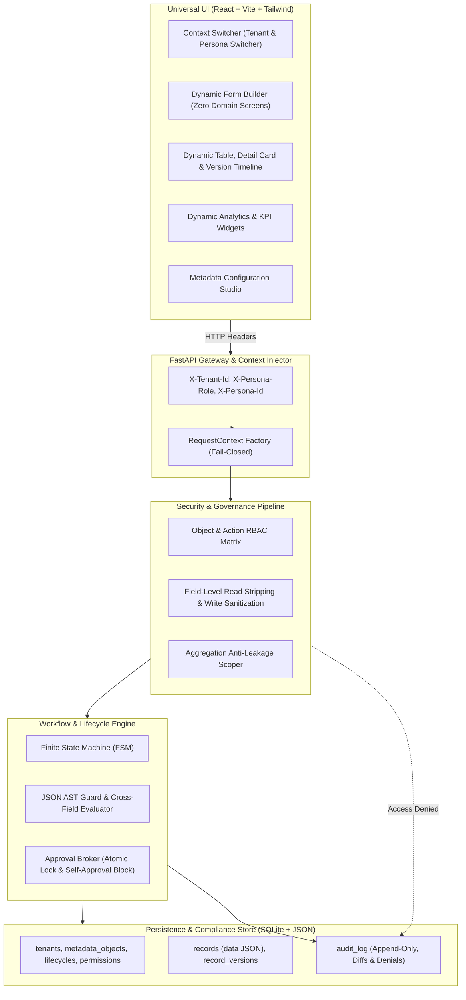

# Metadata-Driven Governed Workflow Platform (GovFlow)

A multi-tenant, domain-agnostic enterprise workflow and governance platform built strictly from metadata. Proved by executing two distinct business domains (**Procurement Operations** and **Facilities & Maintenance**) on the **exact same unmodified codebase with zero domain-specific code**.

---

## 1. System Architecture Overview

GovFlow is built with a strict separation between metadata definitions, user interface rendering, security projection, state machine lifecycle transitions, and persistence:



### Key Architectural Guarantees
1. **Zero Domain-Specific Code**: Neither the backend nor the frontend contains a single hardcoded reference to any specific domain (e.g., zero occurrences of `Vendor`, `Purchase Request`, `Asset`, or `Maintenance Job`).
2. **Server-Side Field-Level Security**: Unreadable fields are completely stripped from API responses before transmission.
3. **Dashboard Anti-Leakage**: Aggregations or groupings that depend on fields hidden from the user's role are barred and flagged as `RESTRICTED`—totals and groupings never leak sensitive information.
4. **Self-Approval Refusal**: Requesters are blocked from approving their own submissions (`actor_id != requester_id`).
5. **Double-Approval Concurrency Lock**: Approvals employ SQLite `BEGIN IMMEDIATE` atomic transactions with status preconditions, returning `409 Conflict` on concurrent race attempts.
6. **Append-Only Audit Trail**: Every creation, update, state transition, approval, rejection, and denied attempt is permanently captured with granular field deltas (`old_value` vs `new_value`).

---

## 2. Quickstart & Local Setup

### Prerequisites
- Python 3.9+
- Node.js 18+ and npm

### 2.1 Backend Setup & Run
```bash
# Navigate to repository root
cd "Metadata-Driven Governed Workflow Platform"

# Activate virtual environment
source backend/venv/bin/activate

# Install dependencies (if not already installed)
pip install -r backend/requirements.txt

# Run SQLite DDL initialization and seed dual domains
PYTHONPATH=backend python backend/app/scripts/seed_db.py

# Start FastAPI dev server on port 8000
PYTHONPATH=backend uvicorn app.main:app --port 8000 --host 127.0.0.1 --reload
```
Backend API will be running at `http://127.0.0.1:8000`. Swagger documentation available at `http://127.0.0.1:8000/docs`.

### 2.2 Frontend Setup & Run
```bash
# In a new terminal window:
cd "Metadata-Driven Governed Workflow Platform/frontend"

# Install npm dependencies
npm install

# Start Vite dev server
npm run dev
```
Open your browser at `http://localhost:5173`.

---

## 3. Running Automated Tests

Run the platform regression test suite:
```bash
cd "Metadata-Driven Governed Workflow Platform"
PYTHONPATH=backend ./backend/venv/bin/pytest backend/tests/test_platform.py -v
```

### Test Suite Coverage:
| Test Case | Description | Result |
|:---|:---|:---|
| `test_tenant_isolation` | Tenant A cannot query Tenant B records or metadata through the API | **PASSED** |
| `test_field_projection_procurement` | Requesters cannot see `cost_centre`; Finance can see `cost_centre` | **PASSED** |
| `test_field_projection_facilities` | Technicians cannot see `estimated_cost`; Facilities Lead can see it | **PASSED** |
| `test_cross_field_validation_facilities` | Scheduled end date before start date rejected with `422` | **PASSED** |
| `test_procurement_lifecycle_and_approval_routing` | Amount $\le 5000$ routes to Manager; Amount $> 5000$ routes to Director | **PASSED** |
| `test_self_approval_blocked` | Requester attempting to approve own submission is rejected with `403` | **PASSED** |
| `test_emergency_skips_approval_in_facilities` | 'Emergency' priority maintenance job bypasses approval | **PASSED** |
| `test_dashboard_no_leakage` | Restricted metric fields return `RESTRICTED` status without leaking numbers | **PASSED** |
| `test_audit_log_captures_denied_actions` | Unauthorized attempts are logged in `audit_log` with `outcome='DENIED'` | **PASSED** |
| `test_save_read_flow` | Complete CRUD flow: Create -> Read -> Update -> Read -> Version history verification | **PASSED** |
| `test_cross_tenant_reference_rejected` | Cross-tenant reference injection rejected with `422 Unprocessable Entity` | **PASSED** |
| `test_checkbox_field_persistence` | Dynamic boolean/checkbox fields and conditional visibility attributes persisted | **PASSED** |
| `test_admin_metadata_endpoints` | Administration studio endpoints for dynamic lifecycles and role permissions matrix | **PASSED** |

---

## 4. Domain Proof (Zero Code Changes)

The system seeds and runs two business domains using declarative JSON configuration:

### Tenant A: Procurement Operations (`backend/app/seeds/procurement.json`)
- **Objects**:
  - `vendor`: Vendor Name, Vendor Code, Contact Email.
  - `purchase_request`: Amount, Needed By Date, Business Justification, Vendor (Reference), Cost Centre Code.
- **Workflow & Governance**:
  - Lifecycle: `Draft` $\rightarrow$ `Submitted` $\rightarrow$ `Approved` / `Rejected` $\rightarrow$ `Ordered`.
  - Guard / Routing: Amount $\le 5,000$ requires Manager approval; Amount $> 5,000$ requires Director approval.
  - Field Permissions: Requesters cannot see or edit `cost_centre`; Finance can see and edit `cost_centre`.
- **Personas**:
  - Alice Johnson (`Requester`)
  - Bob Martinez (`Manager`)
  - Carol Danvers (`Director`)
  - Dave Sterling (`Finance`)
  - System Admin (`Admin`)

### Tenant B: Facilities & Maintenance (`backend/app/seeds/facilities.json`)
- **Objects**:
  - `asset`: Asset Name, Building / Floor Location, Category.
  - `maintenance_job`: Urgency/Priority (`Low`, `Medium`, `High`, `Emergency`), Scheduled Start Date, Scheduled End Date, Target Asset (Reference), Estimated Cost.
- **Workflow & Governance**:
  - Cross-Field Rule: `scheduled_end >= scheduled_start`.
  - Lifecycle: `Reported` $\rightarrow$ `Scheduled` $\rightarrow$ `In Progress` $\rightarrow$ `Done` / `Cancelled`.
  - Guard / Routing: 'Emergency' priority skips approval; Estimated cost $> 2,000$ requires Facilities Lead approval.
  - Field Permissions: Technicians cannot see `estimated_cost`; Facilities Lead has full visibility.
- **Personas**:
  - Tom Bradley (`Technician`)
  - Laura Chen (`Facilities Lead`)
  - Facilities Admin (`Admin`)

---

## 5. Documentation Structure
- [**docs/HLSD.md**](docs/HLSD.md): High-Level System Design (Component separation, sequence diagrams, audit logging).
- [**docs/LLD.md**](docs/LLD.md): Low-Level Design (Database DDLs, AST rule syntax, atomic SQLite concurrency locks, edge cases).
- [**docs/BACKEND_ARCHITECTURE.md**](docs/BACKEND_ARCHITECTURE.md): Deep-dive into Backend APIs, CORS & transport guards, core infrastructure modules, security & RBAC projection, workflow state engine, and JSON seed loading.
- [**docs/FRONTEND_ARCHITECTURE.md**](docs/FRONTEND_ARCHITECTURE.md): Deep-dive into Frontend architecture, Dynamic Form builder, Dynamic Table, Record Detail timeline, Approvals inbox, Dashboard widgets, Audit explorer, and Admin Studio.
- [**docs/END_TO_END_FLOWS_AND_METHOD_CHAINS.md**](docs/END_TO_END_FLOWS_AND_METHOD_CHAINS.md): Interactive diagram-driven reference covering backend method chains across classes, UI component encapsulation per view, and the master UI-to-API mapping matrix.
- [**docs/DEFERRED_ITEMS.md**](docs/DEFERRED_ITEMS.md): Architecture scope decisions, technical debt log, scale bottlenecks, and future roadmap.
