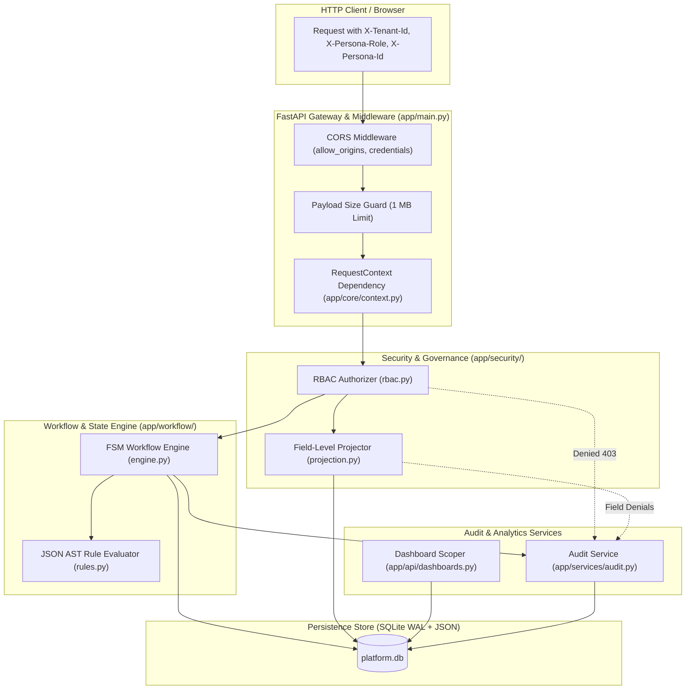
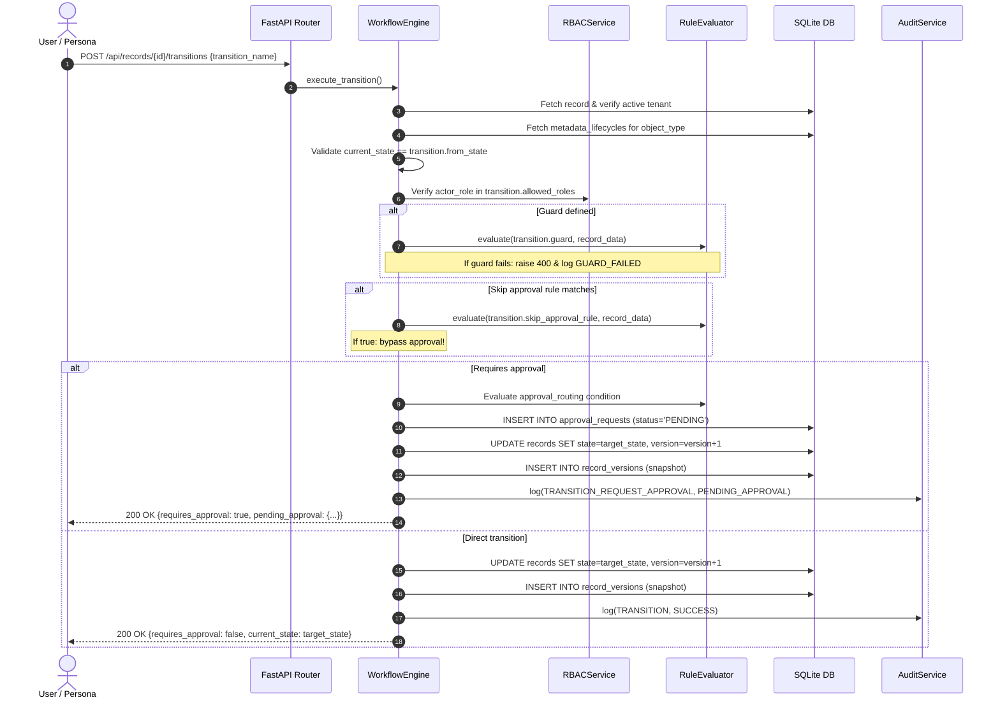
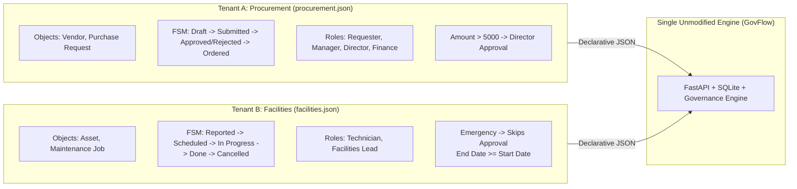

# Backend Architecture & Technical Deep-Dive

The **Metadata-Driven Governed Workflow Platform** backend is a domain-agnostic, multi-tenant enterprise workflow and governance engine built with **FastAPI**, **SQLite (in WAL mode)**, and **Native JSON**. 

The core architectural guarantee of this platform is **zero domain-specific code**: the backend contains zero models, database tables, or business rules hardcoded for any specific industry or application. Instead, all schemas, workflows, validations, permissions, and dashboards are dynamically defined through declarative JSON metadata.

---

## Table of Contents
1. [System Architecture & Component Map](#1-system-architecture--component-map)
2. [CORS Configuration & HTTP Transport Middleware](#2-cors-configuration--http-transport-middleware)
3. [Core Infrastructure Modules](#3-core-infrastructure-modules)
   - [3.1 Configuration (`config.py`)](#31-configuration-configpy)
   - [3.2 Request Context & Header Injection (`context.py`)](#32-request-context--header-injection-contextpy)
   - [3.3 Database Lifecycle & DDL Engine (`database.py`)](#33-database-lifecycle--ddl-engine-databasepy)
4. [Security & Governance Subsystem](#4-security--governance-subsystem)
   - [4.1 Role-Based Access Control (`rbac.py`)](#41-role-based-access-control-rbacpy)
   - [4.2 Field-Level Projection Engine (`projection.py`)](#42-field-level-projection-engine-projectionpy)
   - [4.3 Multi-Tenant Isolation & Boundaries](#43-multi-tenant-isolation--boundaries)
   - [4.4 Concurrency Safety & Double-Approval Defense](#44-concurrency-safety--double-approval-defense)
5. [Workflow Engine & JSON AST Rule Evaluator](#5-workflow-engine--json-ast-rule-evaluator)
   - [5.1 Declarative Rule Evaluator (`rules.py`)](#51-declarative-rule-evaluator-rulespy)
   - [5.2 Lifecycle Finite State Machine & Approvals (`engine.py`)](#52-lifecycle-finite-state-machine--approvals-enginepy)
6. [Seed Engine & JSON Schema Ingestion](#6-seed-engine--json-schema-ingestion)
   - [6.1 Seed Loader Script (`seed_db.py`)](#61-seed-loader-script-seed_dbpy)
   - [6.2 Dual-Domain JSON Seeds (`procurement.json` & `facilities.json`)](#62-dual-domain-json-seeds-procurementjson--facilitiesjson)
   - [6.3 Step-by-Step Seed Ingestion Sequence](#63-step-by-step-seed-ingestion-sequence)
7. [Comprehensive API Reference](#7-comprehensive-api-reference)
   - [7.1 Health Endpoint](#71-health-endpoint)
   - [7.2 Tenants & Personas API](#72-tenants--personas-api)
   - [7.3 Metadata Studio API](#73-metadata-studio-api)
   - [7.4 Records Engine API](#74-records-engine-api)
   - [7.5 Transitions & Lifecycle API](#75-transitions--lifecycle-api)
   - [7.6 Approvals Broker API](#76-approvals-broker-api)
   - [7.7 Analytics & Dashboards API](#77-analytics--dashboards-api)
   - [7.8 Audit & Governance API](#78-audit--governance-api)

---

## 1. System Architecture & Component Map

The backend is composed of five distinct layers operating in a strict, fail-closed pipeline:



---

## 2. CORS Configuration & HTTP Transport Middleware

The entry point of the backend application is defined in [main.py](file:///Users/dhruvsharma/Drive/Others/Assignment/Metadata-Driven%20Governed%20Workflow%20Platform/backend/app/main.py).

### 2.1 CORS Middleware Configuration
Cross-Origin Resource Sharing (CORS) is configured using FastAPI's `CORSMiddleware`:

```python
from fastapi.middleware.cors import CORSMiddleware
from app.core.config import CORS_ORIGINS

app.add_middleware(
    CORSMiddleware,
    allow_origins=CORS_ORIGINS,
    allow_credentials=True,
    allow_methods=["*"],
    allow_headers=["*"],
)
```

#### What is Covered in CORS:
- **Allowed Origins (`allow_origins`)**: Set from `CORS_ORIGINS` in [config.py](file:///Users/dhruvsharma/Drive/Others/Assignment/Metadata-Driven%20Governed%20Workflow%20Platform/backend/app/core/config.py):
  - `http://localhost:5173` (Vite dev server default)
  - `http://127.0.0.1:5173` (Vite dev server loopback)
  - `http://localhost:3000` (Alternate React dev port)
  - `http://127.0.0.1:3000` (Alternate loopback)
  - `*` (Permissive wildcard fallback for containerized and proxy environments)
- **Allowed Credentials (`allow_credentials=True`)**: Enables clients to send HTTP authorization cookies, custom credentials, and state headers.
- **Allowed Methods (`allow_methods=["*"]`)**: Permits all standard HTTP verbs: `GET`, `POST`, `PUT`, `DELETE`, `OPTIONS`, `PATCH`, and `HEAD`.
- **Allowed Headers (`allow_headers=["*"]`)**: Permits all HTTP request headers, crucially including:
  - `Content-Type`: standard JSON payloads.
  - `X-Tenant-Id`: active multi-tenant identifier.
  - `X-Persona-Role`: current persona role (`Requester`, `Manager`, `Director`, `Finance`, `Technician`, `Facilities Lead`, `Admin`).
  - `X-Persona-Id`: unique identifier for the actor (`alice_req`, `bob_mgr`, etc.).

### 2.2 Volumetric Payload Size Guard Middleware
To protect against Distributed Denial of Service (DDoS) attacks and malicious JSON memory bloat, `main.py` incorporates an HTTP middleware that rejects oversized request bodies:

```python
@app.middleware("http")
async def limit_payload_size(request: Request, call_next):
    content_length = request.headers.get("content-length")
    if content_length and int(content_length) > MAX_PAYLOAD_BYTES:
        return JSONResponse(
            status_code=413,
            content={"detail": "Payload too large. Maximum request size is 1MB."}
        )
    return await call_next(request)
```
- **Ceiling**: `MAX_PAYLOAD_BYTES = 1024 * 1024` (1 Megabyte).
- **Behavior**: If a client attempts to submit a payload exceeding 1MB, FastAPI short-circuits execution before reading or parsing the body into memory, returning `413 Payload Too Large`.

### 2.3 Application Startup & Lifespan Management
FastAPI's modern `@asynccontextmanager` lifecycle hook ensures that the database schema is automatically verified, initialized, and seeded on server boot:

```python
@asynccontextmanager
async def lifespan(app: FastAPI):
    if not os.path.exists(DB_PATH):
        init_database(DB_PATH)
        seed_database(DB_PATH)
    yield
```

---

## 3. Core Infrastructure Modules

The `app.core` package provides the low-level foundation for database access, configuration, and request authentication.

### 3.1 Configuration (`config.py`)
File: [config.py](file:///Users/dhruvsharma/Drive/Others/Assignment/Metadata-Driven%20Governed%20Workflow%20Platform/backend/app/core/config.py)

Contains environment-aware system settings:
| Constant | Default Value | Purpose |
|:---|:---|:---|
| `BASE_DIR` | `Path(__file__).parent.parent.parent` | Root directory of the backend repository |
| `DB_PATH` | `os.environ.get("SQLITE_PATH", BASE_DIR / "platform.db")` | Absolute filesystem path to SQLite database |
| `CORS_ORIGINS` | `["http://localhost:5173", ... "*"]` | Authorized origin whitelist |
| `DEFAULT_PAGE_SIZE` | `20` | Default record list pagination limit |
| `MAX_PAGE_SIZE` | `100` | Maximum allowable pagination limit per query |
| `MAX_PAYLOAD_BYTES` | `1048576` (1MB) | Maximum allowable HTTP request body size |

### 3.2 Request Context & Header Injection (`context.py`)
File: [context.py](file:///Users/dhruvsharma/Drive/Others/Assignment/Metadata-Driven%20Governed%20Workflow%20Platform/backend/app/core/context.py)

GovFlow utilizes an immutable, dataclass-based request context injected into every route via FastAPI's `Depends(get_request_context)`:

```python
@dataclass(frozen=True)
class RequestContext:
    tenant_id: str
    actor_id: str
    actor_role: str
```

#### Fail-Closed Header Validation Pipeline:
1. **Header Extraction**: Extracts `X-Tenant-Id`, `X-Persona-Role`, and `X-Persona-Id`.
2. **Missing Header Check**:
   - If `X-Tenant-Id` is missing: immediately raises `400 Bad Request ("Missing required header: X-Tenant-Id")`.
   - If `X-Persona-Role` is missing: immediately raises `400 Bad Request ("Missing required header: X-Persona-Role")`.
3. **Tenant Existence Verification**:
   - Executes `SELECT id FROM tenants WHERE id = ?;`.
   - If the tenant does not exist in the database, immediately raises `404 Not Found ("Tenant '<id>' does not exist")`.
4. **Actor ID Defaulting**:
   - If `X-Persona-Id` is omitted, defaults cleanly to `actor_{role.lower()}`.
5. **Immutability**:
   - Returns a `frozen=True` instance of `RequestContext` preventing mutation downstream.

### 3.3 Database Lifecycle & DDL Engine (`database.py`)
File: [database.py](file:///Users/dhruvsharma/Drive/Others/Assignment/Metadata-Driven%20Governed%20Workflow%20Platform/backend/app/core/database.py)

#### Connection Configuration & SQLite PRAGMAs:
```python
def get_connection(db_path: str = DB_PATH) -> sqlite3.Connection:
    conn = sqlite3.connect(db_path, timeout=10.0, check_same_thread=False)
    conn.row_factory = sqlite3.Row
    conn.execute("PRAGMA journal_mode = WAL;")
    conn.execute("PRAGMA foreign_keys = ON;")
    conn.execute("PRAGMA busy_timeout = 5000;")
    return conn
```
- **`PRAGMA journal_mode = WAL;`**: Write-Ahead Logging allows simultaneous concurrent readers and one writer without read-write blocking.
- **`PRAGMA foreign_keys = ON;`**: Enforces strict referential integrity across relational tables (`ON DELETE CASCADE`).
- **`PRAGMA busy_timeout = 5000;`**: If another thread holds an exclusive lock, SQLite waits up to 5,000ms before raising a `busy` error.
- **`conn.row_factory = sqlite3.Row`**: Enables key-value dictionary access to columns by name.

#### Schema Table Definitions:
The database contains 8 relational tables designed for multi-tenancy and metadata governance:
1. **`tenants`**: Registered enterprise tenants (`id`, `name`, `description`, `created_at`).
2. **`metadata_objects`**: Entity definitions (`tenant_id`, `object_type`, `label`, `schema_definition` JSON, `validation_rules` JSON, `version`).
3. **`metadata_lifecycles`**: State machines (`tenant_id`, `object_type`, `initial_state`, `states` JSON, `transitions` JSON, `version`).
4. **`metadata_permissions`**: RBAC matrix (`tenant_id`, `object_type`, `role`, `can_create`, `can_read`, `can_update`, `can_delete`, `field_permissions` JSON, `transition_permissions` JSON, `approval_permissions` JSON).
5. **`records`**: Dynamic record instances (`id`, `tenant_id`, `object_type`, `state`, `version`, `created_by`, `updated_by`, `data` JSON, `is_deleted`).
6. **`record_versions`**: Immutable point-in-time snapshots of every version of a record (`id`, `tenant_id`, `record_id`, `version`, `state`, `data` JSON, `changed_by`, `changed_at`).
7. **`approval_requests`**: Pending and historical approval gates (`id`, `tenant_id`, `record_id`, `transition_name`, `target_state`, `requester_id`, `required_role`, `status`, `decision_by`, `decision_role`, `decision_reason`, `decided_at`).
8. **`audit_log`**: Append-only compliance log (`id`, `tenant_id`, `actor_id`, `actor_role`, `action`, `object_type`, `record_id`, `outcome`, `reason`, `before_state`, `after_state`, `field_diffs` JSON, `timestamp`).
9. **`dashboards`**: Aggregated analytics definitions (`id`, `tenant_id`, `title`, `widgets` JSON).

---

## 4. Security & Governance Subsystem

Security is enforced **strictly server-side** across multiple layers. The UI is purely an adaptive reflection of permissions.

### 4.1 Role-Based Access Control (`rbac.py`)
File: [rbac.py](file:///Users/dhruvsharma/Drive/Others/Assignment/Metadata-Driven%20Governed%20Workflow%20Platform/backend/app/security/rbac.py)

The `RBACService` evaluates permissions dynamically on every request based on the tuple:
$$\text{Permission} = f(\text{tenant\_id}, \text{object\_type}, \text{role})$$

#### Key RBAC Functions:
1. **`get_permissions(db, tenant_id, object_type, role)`**:
   - Queries `metadata_permissions` table.
   - Returns a structured dictionary:
     ```json
     {
       "can_create": true,
       "can_read": true,
       "can_update": false,
       "can_delete": false,
       "field_permissions": {
         "amount": {"read": true, "edit": true},
         "cost_centre": {"read": false, "edit": false}
       },
       "transition_permissions": ["submit"],
       "approval_permissions": []
     }
     ```
2. **Admin Synthesis Fallback**:
   - If the calling role is `"Admin"` and no explicit permission row was defined for that object, `RBACService` dynamically inspects the object's `schema_definition` in `metadata_objects` and synthesizes **full permissions**:
     - `can_create = True`, `can_read = True`, `can_update = True`, `can_delete = True`
     - Every schema field receives `{"read": True, "edit": True}`
     - `transition_permissions = ["*"]`, `approval_permissions = ["*"]`
3. **Fail-Closed Default**:
   - For non-Admin roles without an explicit permission entry, all permissions evaluate to `False` / empty arrays.
4. **`can_perform(db, tenant_id, object_type, role, action)`**:
   - Helper returning a boolean for `"create"`, `"read"`, `"update"`, or `"delete"`.

### 4.2 Field-Level Projection Engine (`projection.py`)
File: [projection.py](file:///Users/dhruvsharma/Drive/Others/Assignment/Metadata-Driven%20Governed%20Workflow%20Platform/backend/app/security/projection.py)

The `FieldProjector` guarantees zero data leakage of restricted fields.

#### 1. Zero-Leakage Read Stripping (`project_read_record`)
- Inspects the record's dynamic `data` JSON dictionary.
- Compares each key against `field_permissions[field_name]["read"]`.
- **Completely strips any field** where `read != True`.
- **Recursive Timeline Projection**: If historical snapshots (`versions`) are included in the payload, the projector iterates through each historical version and strips restricted fields from past snapshots as well!

#### 2. Write Sanitization & Forbidden Field Detection (`validate_and_filter_write`)
- When a user submits a payload (`POST` create or `PUT` update), the projector checks each submitted key against `field_permissions[field_name]["edit"]`.
- Separates fields into `(sanitized_data, forbidden_fields)`.
- If `forbidden_fields` is non-empty, the API aborts with `403 Forbidden` and logs an unauthorized write attempt in `audit_log`.

#### 3. Dashboard Anti-Leakage Verification (`can_read_fields`)
- Used by the analytics engine.
- Given a list of fields participating in a metric calculation or `group_by` clause:
  - Verifies that `field_permissions[field]["read"] == True` for all referenced fields.
  - If any participating field is unreadable by the user's role, the calculation is blocked and flagged as `RESTRICTED`.

### 4.3 Multi-Tenant Isolation & Boundaries
Multi-tenant integrity is guaranteed through three structural controls:
1. **Query-Level Scoping**: Every SQL query across `records`, `metadata_objects`, `metadata_lifecycles`, `approval_requests`, `audit_log`, and `dashboards` includes `WHERE tenant_id = ?`.
2. **Foreign-Key Reference Isolation**:
   When creating or updating a record that references another record (e.g. `vendor_id` referencing a `vendor`), `records.py` verifies that the referenced record exists **within the active tenant**:
   ```python
   cursor.execute("""
       SELECT 1 FROM records
       WHERE id = ? AND tenant_id = ? AND object_type = ? AND is_deleted = 0;
   """, (ref_val, ctx.tenant_id, ref_target))
   ```
   If a user tries to link an ID belonging to a different tenant, the API rejects it with `422 Unprocessable Entity`.
3. **Context Binding**: The tenant ID is sourced exclusively from the verified `RequestContext` header, preventing parameter tampering.

### 4.4 Concurrency Safety & Double-Approval Defense
In enterprise workflow systems, concurrent approvals represent a major vulnerability (e.g., two managers clicking "Approve" simultaneously on the same pending request).

GovFlow resolves this with three safeguards in [engine.py](file:///Users/dhruvsharma/Drive/Others/Assignment/Metadata-Driven%20Governed%20Workflow%20Platform/backend/app/workflow/engine.py):
1. **SQLite `BEGIN IMMEDIATE;` Locking**:
   The approval decision begins an immediate exclusive transaction:
   ```python
   cursor.execute("BEGIN IMMEDIATE;")
   ```
   This reserves a database write lock, preventing concurrent transactions from reading stale pending states.
2. **Precondition Conflict Detection**:
   Verifies that `status == 'PENDING'`. If already approved or rejected by another user, the transaction aborts with:
   - Status code `409 Conflict ("Approval request has already been processed")`.
   - Audit log entry with `outcome="CONFLICT"`.
3. **Self-Approval Refusal**:
   Prevents users from approving their own requests:
   ```python
   if actor_id == requester_id:
       AuditService.log(..., action="SELF_APPROVAL_ATTEMPT", outcome="DENIED")
       raise HTTPException(status_code=403, detail="Self-approval is strictly forbidden")
   ```

---

## 5. Workflow Engine & JSON AST Rule Evaluator

### 5.1 Declarative Rule Evaluator (`rules.py`)
File: [rules.py](file:///Users/dhruvsharma/Drive/Others/Assignment/Metadata-Driven%20Governed%20Workflow%20Platform/backend/app/workflow/rules.py)

The rule engine evaluates declarative JSON Abstract Syntax Tree (AST) expressions without executing dynamic Python code (`eval` is never used).

#### Supported Operators:
| Operator | Functionality | Example |
|:---|:---|:---|
| `==` | Equality comparison | `{"field": "priority", "operator": "==", "value": "Emergency"}` |
| `!=` | Inequality comparison | `{"field": "category", "operator": "!=", "value": "Deprecated"}` |
| `>` | Strictly greater than | `{"field": "amount", "operator": ">", "value": 5000}` |
| `>=` | Greater than or equal | `{"field": "score", "operator": ">=", "value": 80}` |
| `<` | Strictly less than | `{"field": "amount", "operator": "<", "value": 1000}` |
| `<=` | Less than or equal | `{"field": "days", "operator": "<=", "value": 30}` |
| `in` | Set membership | `{"field": "tier", "operator": "in", "value": ["Gold", "Platinum"]}` |
| `not_in` | Negative membership | `{"field": "state", "operator": "not_in", "value": ["Archived"]}` |

#### Advanced Evaluation Capabilities:
1. **Cross-Field Comparisons**: Uses `field_compare` instead of static `value`:
   ```json
   {
     "field": "scheduled_end",
     "operator": ">=",
     "field_compare": "scheduled_start"
   }
   ```
2. **Logical Compounds**: Supports nested `and` and `or` blocks:
   ```json
   {
     "and": [
       {"field": "amount", "operator": ">", "value": 1000},
       {"field": "category", "operator": "==", "value": "Hardware"}
     ]
   }
   ```
3. **Type Normalization**:
   - Dates: Automatically parses ISO strings (`YYYY-MM-DD`) via `date.fromisoformat()` for proper calendar ordering.
   - Numbers: Normalizes string digits to floats for numeric comparisons.

### 5.2 Lifecycle Finite State Machine & Approvals (`engine.py`)
File: [engine.py](file:///Users/dhruvsharma/Drive/Others/Assignment/Metadata-Driven%20Governed%20Workflow%20Platform/backend/app/workflow/engine.py)

The `WorkflowEngine` executes state transitions and manages approval broker routing.

#### Transition Execution Flow (`execute_transition`):


---

## 6. Seed Engine & JSON Schema Ingestion

The seed subsystem proves the platform's domain-agnostic capability by provisioning two completely distinct business domains using declarative JSON metadata alone.

### 6.1 Seed Loader Script (`seed_db.py`)
File: [seed_db.py](file:///Users/dhruvsharma/Drive/Others/Assignment/Metadata-Driven%20Governed%20Workflow%20Platform/backend/app/scripts/seed_db.py)

The script can be executed standalone or automatically triggered on startup:
```bash
PYTHONPATH=backend python backend/app/scripts/seed_db.py
```

### 6.2 Dual-Domain JSON Seeds (`procurement.json` & `facilities.json`)



#### Domain A: Procurement Operations (`backend/app/seeds/procurement.json`)
- **Entities**:
  - `vendor`: `name`, `code`, `contact_email`.
  - `purchase_request`: `amount`, `needed_by`, `justification`, `vendor_id` (reference), `cost_centre`.
- **Cross-Field Validation**: `amount > 0`.
- **Workflow & Approval Routing**:
  - `Draft` $\rightarrow$ `Submitted` $\rightarrow$ `Approved` / `Rejected` $\rightarrow$ `Ordered`.
  - Amount $\le \$5,000 \implies$ Routes to **Manager**.
  - Amount $> \$5,000 \implies$ Routes to **Director**.
- **Field-Level Permissions**:
  - Requesters **cannot read or edit** `cost_centre`.
  - Finance **can read and edit** `cost_centre`.

#### Domain B: Facilities & Maintenance (`backend/app/seeds/facilities.json`)
- **Entities**:
  - `asset`: `name`, `location`, `category`.
  - `maintenance_job`: `priority` (`Low`, `Medium`, `High`, `Emergency`), `scheduled_start`, `scheduled_end`, `asset_id` (reference), `estimated_cost`, `requires_permit`, `permit_reference` (conditionally visible when `requires_permit == true`).
- **Cross-Field Validation**: `scheduled_end >= scheduled_start`.
- **Workflow & Bypass Rules**:
  - `Reported` $\rightarrow$ `Scheduled` $\rightarrow$ `In Progress` $\rightarrow$ `Done` / `Cancelled`.
  - If `priority == 'Emergency'` $\implies$ **Bypasses approval entirely**.
- **Field-Level Permissions**:
  - Technicians **cannot read or edit** `estimated_cost`.
  - Facilities Lead **can read and edit** `estimated_cost`.

### 6.3 Step-by-Step Seed Ingestion Sequence
When `seed_database()` runs, it performs the following ordered steps for each JSON file:

1. **JSON Parsing & Tenant Upsert**:
   - Parses the JSON root and inserts or updates `tenants` (`id`, `name`, `description`) with `ON CONFLICT(id) DO UPDATE`.
2. **Metadata Objects Ingestion**:
   - Loops over `data["objects"]`.
   - Serializes `schema_definition` and `validation_rules` into JSON strings.
   - Inserts into `metadata_objects` with `UNIQUE(tenant_id, object_type)` conflict handling.
3. **Lifecycles & Transitions Ingestion**:
   - Loops over `data["lifecycles"]`.
   - Serializes `states` and `transitions` arrays.
   - Inserts into `metadata_lifecycles` with `UNIQUE(tenant_id, object_type)` conflict handling.
4. **Permissions Matrix Ingestion**:
   - Loops over `data["permissions"]`.
   - Serializes `field_permissions`, `transition_permissions`, and `approval_permissions`.
   - Inserts into `metadata_permissions` with `UNIQUE(tenant_id, object_type, role)` conflict handling.
5. **Dashboards Ingestion**:
   - Loops over `data["dashboards"]`.
   - Serializes widget definitions and inserts into `dashboards`.
6. **Initial Sample Records Ingestion**:
   - Loops over `data["records"]`.
   - Verifies if the record ID already exists; if not:
     - Inserts into `records` with `version = 1`.
     - Inserts the initial snapshot into `record_versions`.
     - Synthesizes an initial entry in `audit_log` with `action="CREATE"`, `outcome="SUCCESS"`, and initial field deltas.

---

## 7. Comprehensive API Reference

All requests must include standard context headers:
```http
X-Tenant-Id: <tenant_id>
X-Persona-Role: <role>
X-Persona-Id: <persona_id>
```

### 7.1 Health Endpoint
#### `GET /health`
- **Description**: Verifies service status and database engine readiness.
- **Headers**: None required.
- **Success Response (200 OK)**:
  ```json
  {
    "status": "HEALTHY",
    "engine": "FastAPI + SQLite + Native JSON"
  }
  ```

---

### 7.2 Tenants & Personas API

#### `GET /api/tenants`
- **Description**: Returns all registered tenants for the tenant switcher.
- **Headers**: None required.
- **Success Response (200 OK)**:
  ```json
  [
    {
      "id": "procurement",
      "name": "Procurement Operations",
      "description": "Enterprise procurement and vendor management workflows"
    },
    {
      "id": "facilities",
      "name": "Facilities & Maintenance",
      "description": "Building operations, equipment maintenance, and facility safety"
    }
  ]
  ```

#### `GET /api/tenants/{tenant_id}/personas`
- **Description**: Returns simulated personas belonging to a specific tenant.
- **Path Parameters**: `tenant_id` (string).
- **Success Response (200 OK)**:
  ```json
  {
    "tenant_id": "procurement",
    "tenant_name": "Procurement Operations",
    "personas": [
      {"id": "alice_req", "name": "Alice Johnson", "role": "Requester"},
      {"id": "bob_mgr", "name": "Bob Martinez", "role": "Manager"},
      {"id": "carol_dir", "name": "Carol Danvers", "role": "Director"},
      {"id": "dave_fin", "name": "Dave Sterling", "role": "Finance"},
      {"id": "admin_proc", "name": "System Admin", "role": "Admin"}
    ]
  }
  ```
- **Error Responses**: `404 Not Found` if tenant seed configuration does not exist.

---

### 7.3 Metadata Studio API

#### `GET /api/metadata/objects`
- **Description**: Lists all metadata objects in the active tenant that the current persona has permission to read.
- **Headers**: `X-Tenant-Id`, `X-Persona-Role`.
- **Success Response (200 OK)**:
  ```json
  [
    {
      "object_type": "purchase_request",
      "label": "Purchase Request",
      "description": "Formal requests to purchase goods or software",
      "version": 1,
      "updated_at": "2026-10-13 12:00:00",
      "can_create": true
    }
  ]
  ```

#### `GET /api/metadata/objects/{object_type}`
- **Description**: Returns the complete definition of an object, including schema fields, cross-field validation rules, permissions annotated per field, and lifecycle state definitions.
- **Path Parameters**: `object_type` (string).
- **Success Response (200 OK)**:
  ```json
  {
    "tenant_id": "procurement",
    "object_type": "purchase_request",
    "label": "Purchase Request",
    "description": "Formal requests to purchase goods or software",
    "version": 1,
    "fields": [
      {
        "name": "amount",
        "label": "Amount ($)",
        "type": "number",
        "required": true,
        "can_read": true,
        "can_edit": true
      },
      {
        "name": "cost_centre",
        "label": "Cost Centre Code",
        "type": "text",
        "required": false,
        "can_read": false,
        "can_edit": false
      }
    ],
    "validation_rules": [
      {
        "rule_name": "positive_amount",
        "expression": {"field": "amount", "operator": ">", "value": 0},
        "error_message": "Purchase request amount must be greater than zero."
      }
    ],
    "lifecycle": {
      "initial_state": "Draft",
      "states": ["Draft", "Submitted", "Approved", "Rejected", "Ordered"],
      "transitions": [...]
    }
  }
  ```
- **Error Responses**:
  - `403 Forbidden`: Persona does not have read permissions for this object.
  - `404 Not Found`: Object type does not exist.

#### `POST /api/metadata/objects`
- **Description**: Administrative creation or modification of an object schema.
- **Headers**: `X-Tenant-Id`, `X-Persona-Role` (Must be `"Admin"`).
- **Request Body**:
  ```json
  {
    "object_type": "contract",
    "label": "Vendor Contract",
    "description": "Legal agreements with third-party suppliers",
    "schema_definition": [
      {"name": "contract_title", "label": "Title", "type": "text", "required": true, "display_order": 1},
      {"name": "expiration_date", "label": "Expires", "type": "date", "required": true, "display_order": 2}
    ],
    "validation_rules": [],
    "change_reason": "Introducing contract lifecycle management for Q4 procurement audit compliance"
  }
  ```
- **Guardrails**:
  - **Admin Check**: Rejects non-admin personas with `403 Forbidden`.
  - **Destructive Wipeout Prevention**: If `schema_definition` has $< 1$ field, rejects with `422 Unprocessable Entity`.
  - **Dependency Integrity**: If an admin deletes a field referenced in active lifecycle transition guards, rejects with `422 Unprocessable Entity`.
  - **Audit Justification**: Requires a `change_reason` with $\ge 10$ characters.
- **Success Response (200 OK)**:
  ```json
  {
    "status": "SUCCESS",
    "object_type": "contract",
    "version": 1,
    "change_reason": "Introducing contract lifecycle management for Q4 procurement audit compliance"
  }
  ```

#### `GET /api/metadata/lifecycles/{object_type}`
- **Description**: Returns the lifecycle state machine definition for an object.
- **Success Response (200 OK)**:
  ```json
  {
    "object_type": "purchase_request",
    "initial_state": "Draft",
    "states": ["Draft", "Submitted", "Approved", "Rejected", "Ordered"],
    "transitions": [
      {
        "name": "submit",
        "label": "Submit Request",
        "from_state": "Draft",
        "to_state": "Submitted",
        "allowed_roles": ["Requester"],
        "requires_approval": true,
        "approval_routing": {
          "rule": {
            "condition": {"field": "amount", "operator": ">", "value": 5000},
            "role_if_true": "Director",
            "role_if_false": "Manager"
          }
        }
      }
    ],
    "version": 1
  }
  ```

#### `POST /api/metadata/lifecycles`
- **Description**: Updates the lifecycle transitions and state graph (Admin only).
- **Request Body**:
  ```json
  {
    "object_type": "purchase_request",
    "initial_state": "Draft",
    "states": ["Draft", "Submitted", "Approved", "Rejected", "Ordered"],
    "transitions": [...],
    "change_reason": "Updated approval threshold conditions for finance review"
  }
  ```

#### `GET /api/metadata/permissions/{object_type}`
- **Description**: Returns the complete RBAC matrix across all roles for a given entity.
- **Success Response (200 OK)**: Array of permission rows per role.

#### `POST /api/metadata/permissions`
- **Description**: Saves updated permissions matrix across roles (Admin only).
- **Request Body**:
  ```json
  {
    "object_type": "purchase_request",
    "permissions": [
      {
        "role": "Requester",
        "can_create": true,
        "can_read": true,
        "can_update": true,
        "can_delete": false,
        "field_permissions": {
          "amount": {"read": true, "edit": true},
          "cost_centre": {"read": false, "edit": false}
        },
        "transition_permissions": ["submit"],
        "approval_permissions": []
      }
    ],
    "change_reason": "Configured requester permissions according to segregation of duties policy"
  }
  ```

---

### 7.4 Records Engine API

#### `GET /api/records/{object_type}`
- **Description**: Lists paginated records for an entity with state filtering and server-side projection.
- **Query Parameters**:
  - `state` (optional string): filter by record state.
  - `sort_by` (default `"created_at"`): column to sort by (`created_at`, `updated_at`, `state`, `version`).
  - `sort_order` (default `"desc"`): `"asc"` or `"desc"`.
  - `limit` (default `20`, max `100`): pagination limit.
  - `offset` (default `0`): pagination offset.
- **Success Response (200 OK)**:
  ```json
  {
    "object_type": "purchase_request",
    "total": 4,
    "limit": 20,
    "offset": 0,
    "items": [
      {
        "id": "pr_001",
        "tenant_id": "procurement",
        "object_type": "purchase_request",
        "state": "Submitted",
        "version": 2,
        "created_by": "alice_req",
        "created_at": "2026-10-13 10:00:00",
        "updated_at": "2026-10-13 10:15:00",
        "data": {
          "amount": 4500,
          "needed_by": "2026-11-01",
          "justification": "New engineer workstations",
          "vendor_id": "vend_001"
        }
      }
    ]
  }
  ```
  *(Notice: `cost_centre` is completely stripped if caller is `Requester`)*

#### `GET /api/records/{object_type}/{record_id}`
- **Description**: Returns deep record details, including historical version snapshots and pending approval status.
- **Success Response (200 OK)**:
  ```json
  {
    "id": "pr_001",
    "tenant_id": "procurement",
    "object_type": "purchase_request",
    "state": "Submitted",
    "version": 2,
    "created_by": "alice_req",
    "data": {
      "amount": 4500,
      "needed_by": "2026-11-01"
    },
    "versions": [
      {
        "version": 2,
        "state": "Submitted",
        "data": {"amount": 4500, "needed_by": "2026-11-01"},
        "changed_by": "alice_req",
        "changed_at": "2026-10-13 10:15:00"
      },
      {
        "version": 1,
        "state": "Draft",
        "data": {"amount": 4000, "needed_by": "2026-11-01"},
        "changed_by": "alice_req",
        "changed_at": "2026-10-13 10:00:00"
      }
    ],
    "pending_approval": {
      "id": "appr_999",
      "transition_name": "submit",
      "target_state": "Submitted",
      "requester_id": "alice_req",
      "required_role": "Manager",
      "status": "PENDING",
      "created_at": "2026-10-13 10:15:00",
      "can_approve": true
    }
  }
  ```

#### `POST /api/records/{object_type}`
- **Description**: Creates a new record instance.
- **Validation Pipeline**:
  1. Checks `RBACService.can_perform(create)`.
  2. Strips un-editable fields; rejects if any forbidden fields were submitted (`403 Forbidden`).
  3. Validates required schema fields (`422 Unprocessable Entity`).
  4. Validates foreign-key reference target exists in active tenant (`422 Unprocessable Entity`).
  5. Evaluates cross-field validation rules via `RuleEvaluator` (`422 Unprocessable Entity`).
  6. Assigns `initial_state`, writes version 1 snapshot, writes `audit_log` with granular deltas.
- **Request Body**:
  ```json
  {
    "data": {
      "amount": 7500,
      "needed_by": "2026-12-01",
      "justification": "Cloud server reserved instances",
      "vendor_id": "vend_002"
    }
  }
  ```
- **Success Response (200 OK)**:
  ```json
  {
    "id": "c1f7a0b3-90d1-41e9-8e42-123456789abc",
    "tenant_id": "procurement",
    "object_type": "purchase_request",
    "state": "Draft",
    "version": 1,
    "created_by": "alice_req",
    "data": {
      "amount": 7500,
      "needed_by": "2026-12-01",
      "justification": "Cloud server reserved instances",
      "vendor_id": "vend_002"
    }
  }
  ```

#### `PUT /api/records/{object_type}/{record_id}`
- **Description**: Updates an existing record's dynamic data fields.
- **Behavior**:
  - Merges submitted changes with existing data.
  - Re-evaluates foreign-key references and cross-field validation rules on merged data.
  - Increments `version`.
  - Appends to `record_versions`.
  - Computes exact field diffs (`compute_field_diff(old, new)`) and persists to `audit_log`.
- **Request Body**:
  ```json
  {
    "data": {
      "amount": 8000
    }
  }
  ```
- **Success Response (200 OK)**: Projected updated record payload.

#### `DELETE /api/records/{object_type}/{record_id}`
- **Description**: Soft-deletes a record (`is_deleted = 1`).
- **Success Response (200 OK)**:
  ```json
  {
    "status": "SUCCESS",
    "record_id": "pr_001",
    "is_deleted": true
  }
  ```

---

### 7.5 Transitions & Lifecycle API

#### `POST /api/records/{record_id}/transitions`
- **Description**: Triggers a state transition on a record governed by the lifecycle FSM.
- **Request Body**:
  ```json
  {
    "transition_name": "submit"
  }
  ```
- **Success Response (Requires Approval)**:
  ```json
  {
    "record_id": "pr_001",
    "previous_state": "Draft",
    "current_state": "Submitted",
    "requires_approval": true,
    "pending_approval": {
      "id": "e0a29367-9c91-4cf4-9118-2895693d25fa",
      "required_role": "Manager",
      "target_state": "Submitted"
    }
  }
  ```
- **Success Response (Direct Transition)**:
  ```json
  {
    "record_id": "job_101",
    "previous_state": "Reported",
    "current_state": "Scheduled",
    "requires_approval": false
  }
  ```
- **Error Responses**:
  - `400 Bad Request`: Invalid transition from current state, or transition guard condition failed.
  - `403 Forbidden`: Current persona role is not authorized to trigger this transition.
  - `404 Not Found`: Record not found.

---

### 7.6 Approvals Broker API

#### `GET /api/approvals/pending`
- **Description**: Lists pending approval requests waiting for decision. Non-admins only see requests matching their assigned role.
- **Success Response (200 OK)**:
  ```json
  [
    {
      "id": "e0a29367-9c91-4cf4-9118-2895693d25fa",
      "record_id": "pr_001",
      "object_type": "purchase_request",
      "current_record_state": "Submitted",
      "transition_name": "submit",
      "target_state": "Submitted",
      "requester_id": "alice_req",
      "required_role": "Manager",
      "created_at": "2026-10-13 10:15:00",
      "can_approve": true
    }
  ]
  ```

#### `POST /api/approvals/{approval_id}/decision`
- **Description**: Resolves a pending approval with an `APPROVE` or `REJECT` decision.
- **Concurrency & Governance Checks**:
  1. `BEGIN IMMEDIATE` lock.
  2. Conflict check (`409 Conflict` if already resolved).
  3. Self-approval block (`403 Forbidden` if `actor_id == requester_id`).
  4. Approver role match (`403 Forbidden` if role mismatch).
- **Request Body**:
  ```json
  {
    "decision": "APPROVE",
    "reason": "Approved after reviewing vendor quotes and budget allocation."
  }
  ```
- **Success Response (200 OK)**:
  ```json
  {
    "approval_id": "e0a29367-9c91-4cf4-9118-2895693d25fa",
    "record_id": "pr_001",
    "status": "APPROVED",
    "new_record_state": "Approved"
  }
  ```

---

### 7.7 Analytics & Dashboards API

#### `GET /api/dashboards`
- **Description**: Returns available dashboards for the active tenant.

#### `GET /api/dashboards/{dashboard_id}`
- **Description**: Computes metrics and aggregates for dashboard widgets with strict anti-leakage field scoping.
- **Success Response (200 OK)**:
  ```json
  {
    "id": "procurement_overview",
    "title": "Procurement Operations Overview",
    "tenant_id": "procurement",
    "widgets": [
      {
        "widget_id": "total_spend",
        "title": "Total Spend",
        "type": "kpi",
        "status": "AVAILABLE",
        "value": 12500,
        "aggregation": "sum"
      },
      {
        "widget_id": "restricted_metric",
        "title": "Cost Centre Allocation",
        "type": "chart",
        "status": "RESTRICTED",
        "error": "This metric is hidden because it aggregates or groups by restricted fields."
      }
    ]
  }
  ```

---

### 7.8 Audit & Governance API

#### `GET /api/audit`
- **Description**: Retrieves immutable compliance audit logs with field deltas and access denial captures.
- **Query Parameters**:
  - `object_type` (optional string): filter by entity type.
  - `record_id` (optional string): filter by specific record.
  - `outcome` (optional string): `SUCCESS`, `DENIED`, `CONFLICT`, `GUARD_FAILED`, `FAILED_VALIDATION`.
  - `limit` (default `50`, max `100`).
- **Success Response (200 OK)**:
  ```json
  [
    {
      "id": 42,
      "tenant_id": "procurement",
      "actor_id": "alice_req",
      "actor_role": "Requester",
      "action": "SELF_APPROVAL_ATTEMPT",
      "object_type": "purchase_request",
      "record_id": "pr_001",
      "outcome": "DENIED",
      "reason": "Self-approval is strictly forbidden",
      "before_state": null,
      "after_state": null,
      "field_diffs": null,
      "timestamp": "2026-10-13 10:20:00"
    },
    {
      "id": 41,
      "tenant_id": "procurement",
      "actor_id": "bob_mgr",
      "actor_role": "Manager",
      "action": "UPDATE",
      "object_type": "purchase_request",
      "record_id": "pr_001",
      "outcome": "SUCCESS",
      "reason": "Record data updated",
      "before_state": "Draft",
      "after_state": "Draft",
      "field_diffs": {
        "amount": {"old": 4000, "new": 4500}
      },
      "timestamp": "2026-10-13 10:15:00"
    }
  ]
  ```
