# End-to-End Flows, Method Chains & UI-to-API Architecture

This document provides a comprehensive, diagram-driven reference explaining:
1. **Backend Method Chains**: How methods invoke one another across classes and modules for every core end-to-end operation.
2. **UI Component Encapsulation & Flow**: How frontend components nest, encapsulate state, and trigger reactive updates for every view and page.
3. **UI-to-API Mapping Matrix**: The exact linkage between user interactions, client services, HTTP routes, backend services, and database persistence.

---

## Table of Contents
1. [System Interaction Topology](#1-system-interaction-topology)
2. [Backend Method Chains Across Classes](#2-backend-method-chains-across-classes)
   - [2.1 Flow 1: Record Creation Flow](#21-flow-1-record-creation-flow)
   - [2.2 Flow 2: Record Read & Detail Inspection Flow](#22-flow-2-record-read--detail-inspection-flow)
   - [2.3 Flow 3: Record Update & Delta Computation Flow](#23-flow-3-record-update--delta-computation-flow)
   - [2.4 Flow 4: Lifecycle State Transition Flow](#24-flow-4-lifecycle-state-transition-flow)
   - [2.5 Flow 5: Atomic Approval Decision Flow](#25-flow-5-atomic-approval-decision-flow)
   - [2.6 Flow 6: Anti-Leakage Analytics Metric Flow](#26-flow-6-anti-leakage-analytics-metric-flow)
   - [2.7 Flow 7: Metadata Administration Mutation Flow](#27-flow-7-metadata-administration-mutation-flow)
   - [2.8 Flow 8: Database Bootstrapping & Seed Flow](#28-flow-8-database-bootstrapping--seed-flow)
3. [UI Component Encapsulation & View Flows](#3-ui-component-encapsulation--view-flows)
   - [3.1 Component Encapsulation Hierarchy](#31-component-encapsulation-hierarchy)
   - [3.2 Context Switcher & Shell Flow (`ContextSwitcher` $\leftrightarrow$ `App`)](#32-context-switcher--shell-flow-contextswitcher--app)
   - [3.3 Records Workspace Flow (`DynamicTable` $\leftrightarrow$ `RecordDetail` $\leftrightarrow$ `DynamicForm`)](#33-records-workspace-flow-dynamictable--recorddetail--dynamicform)
   - [3.4 Approvals Governance Inbox Flow (`ApprovalsView`)](#34-approvals-governance-inbox-flow-approvalsview)
   - [3.5 Analytics & KPI Dashboard Flow (`DashboardView`)](#35-analytics--kpi-dashboard-flow-dashboardview)
   - [3.6 Compliance & Forensics Audit Explorer Flow (`AuditView`)](#36-compliance--forensics-audit-explorer-flow-auditview)
   - [3.7 Visual Metadata Administration Studio Flow (`AdminStudio`)](#37-visual-metadata-administration-studio-flow-adminstudio)
4. [Master UI-to-API Mapping Matrix](#4-master-ui-to-api-mapping-matrix)
5. [End-to-End User Journey Sequence Diagrams](#5-end-to-end-user-journey-sequence-diagrams)

---

## 1. System Interaction Topology

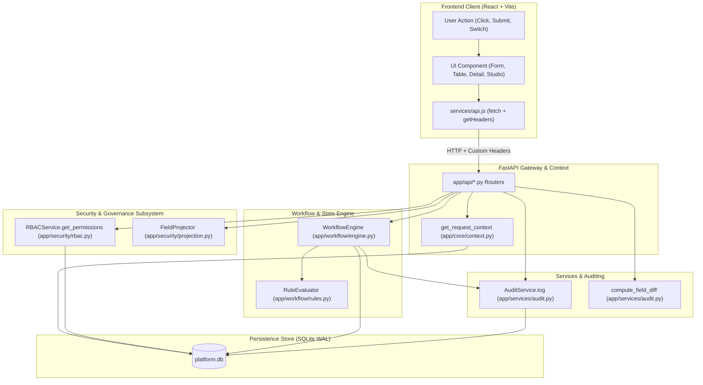

---

## 2. Backend Method Chains Across Classes

### 2.1 Flow 1: Record Creation Flow
Triggered by: `POST /api/records/{object_type}`

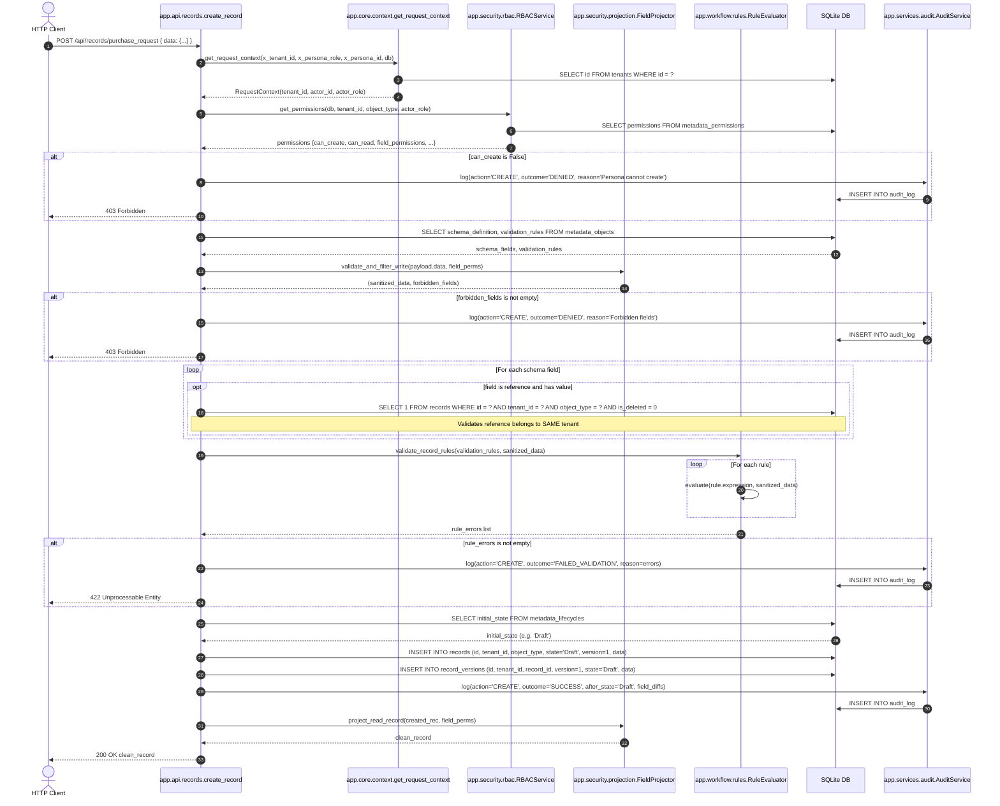

#### Method Call Sequence:
1. `app.core.context:get_request_context()` validates headers and verifies tenant.
2. `app.security.rbac:RBACService.get_permissions()` verifies `can_create`.
3. `app.security.projection:FieldProjector.validate_and_filter_write()` verifies that every submitted key has `edit: True`.
4. Tenant Foreign Key Guard checks that referenced entities exist in the same tenant.
5. `app.workflow.rules:RuleEvaluator.validate_record_rules()` calls `RuleEvaluator.evaluate()` for all cross-field rules.
6. DB insertion into `records` and `record_versions`.
7. `app.services.audit:AuditService.log()` permanently records initial field creation.
8. `app.security.projection:FieldProjector.project_read_record()` strips unreadable fields before returning payload.

---

### 2.2 Flow 2: Record Read & Detail Inspection Flow
Triggered by: `GET /api/records/{object_type}/{record_id}`

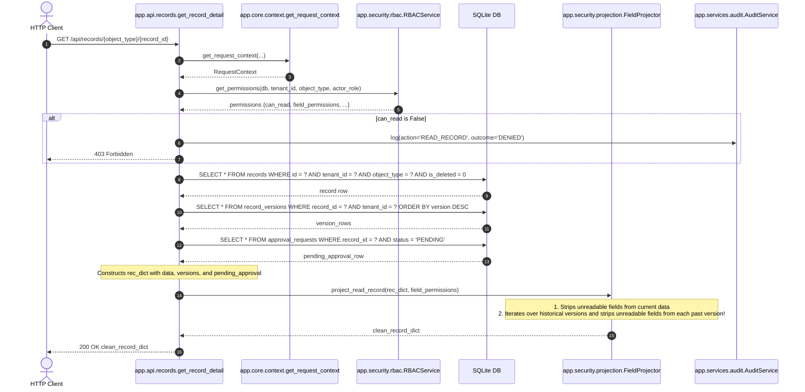

#### Method Call Sequence:
1. `app.core.context:get_request_context()` produces tenant and persona credentials.
2. `app.security.rbac:RBACService.get_permissions()` validates `can_read`.
3. SQLite queries `records`, `record_versions`, and `approval_requests`.
4. `app.security.projection:FieldProjector.project_read_record()` executes recursive projection:
   - Strips unreadable fields from `rec_dict["data"]`.
   - Iterates through `rec_dict["versions"]` and strips unreadable fields from every snapshot `v["data"]`.

---

### 2.3 Flow 3: Record Update & Delta Computation Flow
Triggered by: `PUT /api/records/{object_type}/{record_id}`

```mermaid
sequenceDiagram
    autonumber
    actor Client as HTTP Client
    participant RecordsAPI as app.api.records.update_record
    participant RBAC as app.security.rbac.RBACService
    participant Projector as app.security.projection.FieldProjector
    participant Rules as app.workflow.rules.RuleEvaluator
    participant Diff as app.services.audit.compute_field_diff
    participant Audit as app.services.audit.AuditService
    participant DB as SQLite DB

    Client->>RecordsAPI: PUT /api/records/{type}/{id} { data: { amount: 5500 } }
    RecordsAPI->>RBAC: get_permissions(db, tenant_id, object_type, actor_role)
    RBAC-->>RecordsAPI: permissions

    alt can_update is False
        RecordsAPI->>Audit: log(action='UPDATE', outcome='DENIED')
        RecordsAPI-->>Client: 403 Forbidden
    end

    RecordsAPI->>DB: SELECT state, version, data FROM records WHERE id = ?
    DB-->>RecordsAPI: existing record

    RecordsAPI->>Projector: validate_and_filter_write(payload.data, field_perms)
    Projector-->>RecordsAPI: (sanitized_delta, forbidden_fields)

    alt forbidden_fields is not empty
        RecordsAPI->>Audit: log(action='UPDATE', outcome='DENIED', reason='Forbidden fields')
        RecordsAPI-->>Client: 403 Forbidden
    end

    Note over RecordsAPI: merged_data = old_data.copy(); merged_data.update(sanitized_delta)

    RecordsAPI->>Rules: validate_record_rules(validation_rules, merged_data)
    Rules-->>RecordsAPI: rule_errors

    alt rule_errors is not empty
        RecordsAPI->>Audit: log(action='UPDATE', outcome='FAILED_VALIDATION')
        RecordsAPI-->>Client: 422 Unprocessable Entity
    end

    RecordsAPI->>Diff: compute_field_diff(old_data, merged_data)
    Note over Diff: Identifies deltas: { amount: { old: 4000, new: 5500 } }
    Diff-->>RecordsAPI: field_diffs

    RecordsAPI->>DB: UPDATE records SET data = ?, version = version + 1 WHERE id = ?
    RecordsAPI->>DB: INSERT INTO record_versions (id, version, state, data, changed_by)

    RecordsAPI->>Audit: log(action='UPDATE', outcome='SUCCESS', field_diffs=field_diffs)
    Audit->>DB: INSERT INTO audit_log

    RecordsAPI->>Projector: project_read_record(updated_rec, field_perms)
    Projector-->>RecordsAPI: clean_record
    RecordsAPI-->>Client: 200 OK clean_record
```

#### Method Call Sequence:
1. `app.security.rbac:RBACService.get_permissions()` checks `can_update`.
2. `app.security.projection:FieldProjector.validate_and_filter_write()` verifies that only editable fields are being altered.
3. Merged data is validated against foreign key references and `RuleEvaluator.validate_record_rules()`.
4. `app.services.audit:compute_field_diff(old_data, merged_data)` calculates exact key-value deltas.
5. `records` is updated and a new snapshot is written to `record_versions`.
6. `app.services.audit:AuditService.log()` captures the change with the computed deltas.
7. `app.security.projection:FieldProjector.project_read_record()` projects the response.

---

### 2.4 Flow 4: Lifecycle State Transition Flow
Triggered by: `POST /api/records/{record_id}/transitions`

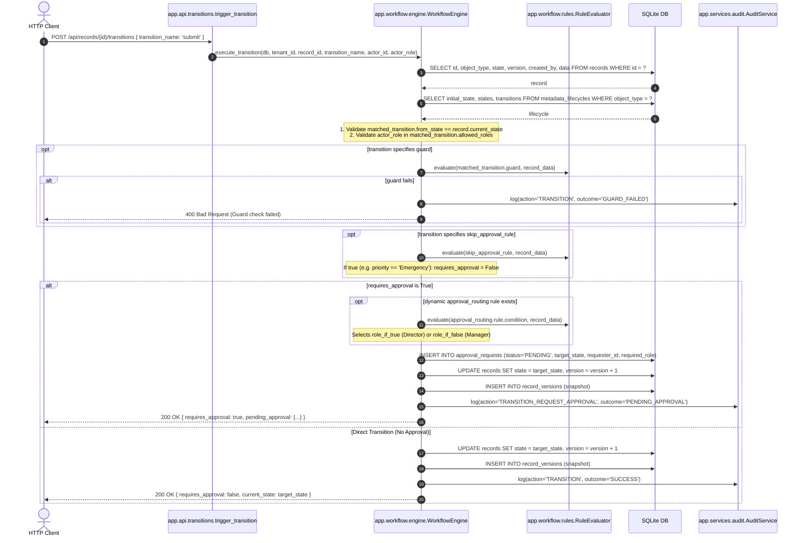

#### Method Call Sequence:
1. `app.workflow.engine:WorkflowEngine.execute_transition()` loads the record and lifecycle state machine.
2. Validates `from_state == current_state` and checks actor role authorization.
3. `app.workflow.rules:RuleEvaluator.evaluate()` evaluates any `guard` expression.
4. `RuleEvaluator.evaluate()` checks `skip_approval_rule`.
5. If approval is required:
   - `RuleEvaluator.evaluate()` executes `approval_routing.rule.condition`.
   - An entry is inserted into `approval_requests`.
   - The record advances state and a new version is created in `record_versions`.
   - `AuditService.log()` captures the pending approval event.

---

### 2.5 Flow 5: Atomic Approval Decision Flow
Triggered by: `POST /api/approvals/{approval_id}/decision`

```mermaid
sequenceDiagram
    autonumber
    actor Approver as Approver / Manager
    participant ApprAPI as app.api.approvals.submit_approval_decision
    participant Engine as app.workflow.engine.WorkflowEngine
    participant DB as SQLite DB
    participant Audit as app.services.audit.AuditService

    Approver->>ApprAPI: POST /api/approvals/{id}/decision { decision: 'APPROVE', reason: 'Verified' }
    ApprAPI->>Engine: execute_approval_decision(db, tenant_id, approval_id, actor_id, actor_role, decision, reason)

    Engine->>DB: BEGIN IMMEDIATE; (Acquires exclusive write lock)
    Engine->>DB: SELECT * FROM approval_requests WHERE id = ? AND tenant_id = ?
    DB-->>Engine: approval

    alt status != 'PENDING' (Race Condition)
        Engine->>Audit: log(action='APPROVAL_DECISION', outcome='CONFLICT')
        Engine->>DB: ROLLBACK;
        Engine-->>Approver: 409 Conflict (Request already processed)
    end

    alt actor_id == requester_id (Self-Approval Attack)
        Engine->>Audit: log(action='SELF_APPROVAL_ATTEMPT', outcome='DENIED')
        Engine->>DB: ROLLBACK;
        Engine-->>Approver: 403 Forbidden (Self-approval is strictly forbidden)
    end

    alt actor_role != required_role and actor_role != 'Admin'
        Engine->>Audit: log(action='APPROVAL_DECISION', outcome='DENIED')
        Engine->>DB: ROLLBACK;
        Engine-->>Approver: 403 Forbidden (Unauthorized approver role)
    end

    Engine->>DB: UPDATE approval_requests SET status = 'APPROVED', decision_by = ?, decided_at = CURRENT_TIMESTAMP WHERE id = ?
    Engine->>DB: UPDATE records SET state = next_record_state, version = version + 1 WHERE id = ?
    Engine->>DB: INSERT INTO record_versions (snapshot)

    Engine->>Audit: log(action='APPROVAL_APPROVED', outcome='SUCCESS')
    Engine->>DB: COMMIT;

    Engine-->>Approver: 200 OK { approval_id, status: 'APPROVED', new_record_state }
```

#### Method Call Sequence:
1. `app.workflow.engine:WorkflowEngine.execute_approval_decision()` opens a `BEGIN IMMEDIATE;` atomic transaction.
2. Checks for race conditions (`status == 'PENDING'`).
3. Blocks self-approval (`actor_id != requester_id`).
4. Verifies role eligibility (`actor_role == required_role` or `Admin`).
5. Updates `approval_requests`, updates `records`, and snapshots `record_versions`.
6. `app.services.audit:AuditService.log()` captures the decision with justification.
7. Commits the transaction.

---

### 2.6 Flow 6: Anti-Leakage Analytics Metric Flow
Triggered by: `GET /api/dashboards/{dashboard_id}`

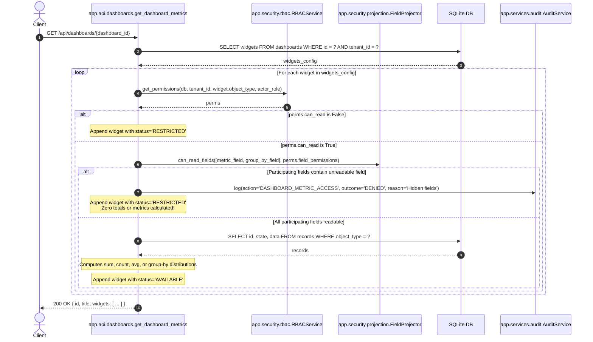

#### Method Call Sequence:
1. `app.security.rbac:RBACService.get_permissions()` verifies object access.
2. `app.security.projection:FieldProjector.can_read_fields()` verifies all fields in `metric.field` and `group_by`.
3. If any field is hidden, `AuditService.log()` logs the denied access and returns `status: "RESTRICTED"` without querying aggregates.
4. If readable, queries records and computes authorized aggregations.

---

### 2.7 Flow 7: Metadata Administration Mutation Flow
Triggered by: `POST /api/metadata/objects`

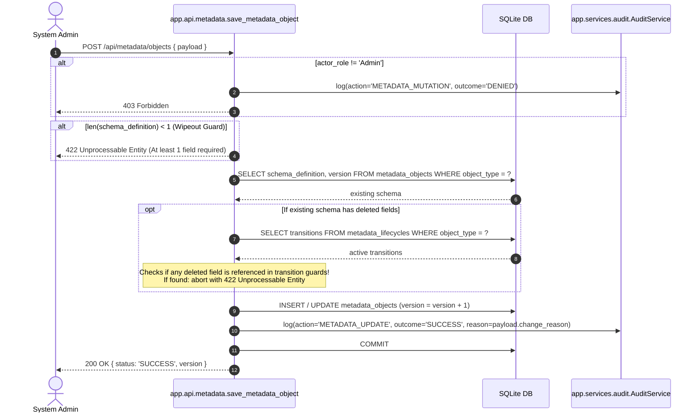

---

### 2.8 Flow 8: Database Bootstrapping & Seed Flow
Triggered by: Server startup (`lifespan`) or standalone script run (`seed_db.py`)

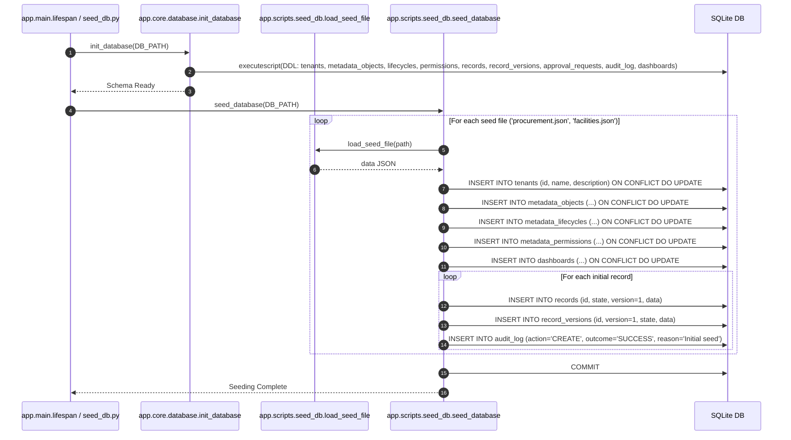

---

## 3. UI Component Encapsulation & View Flows

### 3.1 Component Encapsulation Hierarchy

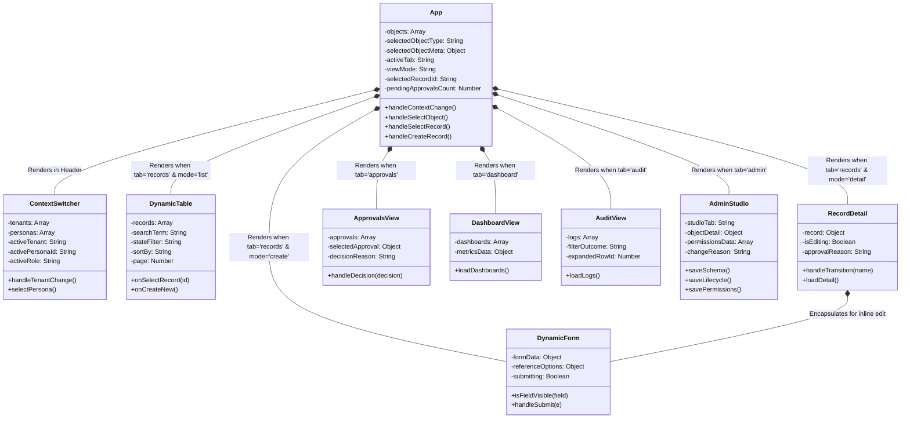

---

### 3.2 Context Switcher & Shell Flow (`ContextSwitcher` $\leftrightarrow$ `App`)

```mermaid
sequenceDiagram
    autonumber
    actor User as User
    participant Switcher as ContextSwitcher.jsx
    participant LocalStore as localStorage
    participant API as services/api.js
    participant AppShell as App.jsx

    User->>Switcher: Selects Tenant "facilities"
    Switcher->>LocalStore: setItem("active_tenant_id", "facilities")
    Switcher->>API: getTenantPersonas("facilities")
    API-->>Switcher: { personas: [Tom Bradley (Technician), ...] }
    Switcher->>LocalStore: setItem("active_persona_id", "tom_tech")
    Switcher->>LocalStore: setItem("active_persona_role", "Technician")
    Switcher->>AppShell: onContextChange()

    AppShell->>AppShell: setViewMode("list"); setSelectedRecordId(null)
    AppShell->>API: getMetadataObjects() (Sends X-Tenant-Id: facilities, X-Persona-Role: Technician)
    API-->>AppShell: [Asset, Maintenance Job]
    AppShell->>API: getMetadataObject("asset")
    API-->>AppShell: asset metadata definition
    AppShell->>API: getPendingApprovals()
    API-->>AppShell: pending approvals list
    AppShell->>AppShell: Re-renders sidebar with Asset & Maintenance Job tabs
```

---

### 3.3 Records Workspace Flow (`DynamicTable` $\leftrightarrow$ `RecordDetail` $\leftrightarrow$ `DynamicForm`)

```mermaid
sequenceDiagram
    autonumber
    actor User as User
    participant Table as DynamicTable.jsx
    participant AppShell as App.jsx
    participant Detail as RecordDetail.jsx
    participant Form as DynamicForm.jsx
    participant API as services/api.js

    Note over AppShell,Table: Mode: 'list'
    Table->>API: getRecords(objectType, { limit, offset, state, sort_by })
    API-->>Table: { items: [...], total }
    Table->>Table: Renders dynamic columns, projected fields, state badges

    User->>Table: Clicks record row
    Table->>AppShell: onSelectRecord(recordId)
    AppShell->>AppShell: setViewMode('detail'); setSelectedRecordId(recordId)

    Note over AppShell,Detail: Mode: 'detail'
    Detail->>API: getRecordDetail(objectType, recordId)
    API-->>Detail: { data, versions, pending_approval }
    Detail->>Detail: Renders field grid, pending banner, transition buttons, version timeline

    opt User Clicks "Edit Record"
        Detail->>Detail: setIsEditing(true)
        Detail->>Form: Renders DynamicForm(initialData=record.data)
        User->>Form: Modifies values and clicks "Save Changes"
        Form->>API: updateRecord(objectType, recordId, formData)
        API-->>Form: updated record
        Form->>Detail: onCancel() / loadDetail()
        Detail->>Detail: Refreshes details & version history timeline
    end

    opt User Clicks Transition Button (e.g. "Submit Request")
        Detail->>API: triggerTransition(recordId, "submit")
        API-->>Detail: { requires_approval: true, current_state: 'Submitted' }
        Detail->>Detail: Displays success notification & reloads detail
    end
```

---

### 3.4 Approvals Governance Inbox Flow (`ApprovalsView`)

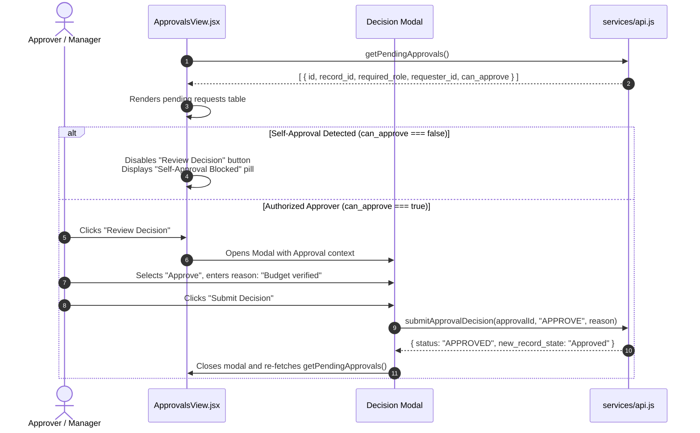

---

### 3.5 Analytics & KPI Dashboard Flow (`DashboardView`)

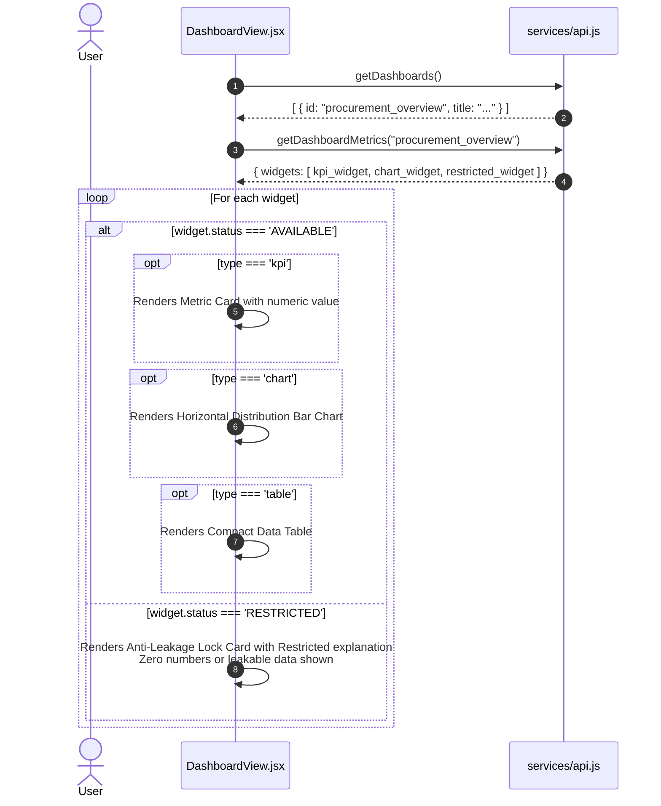

---

### 3.6 Compliance & Forensics Audit Explorer Flow (`AuditView`)

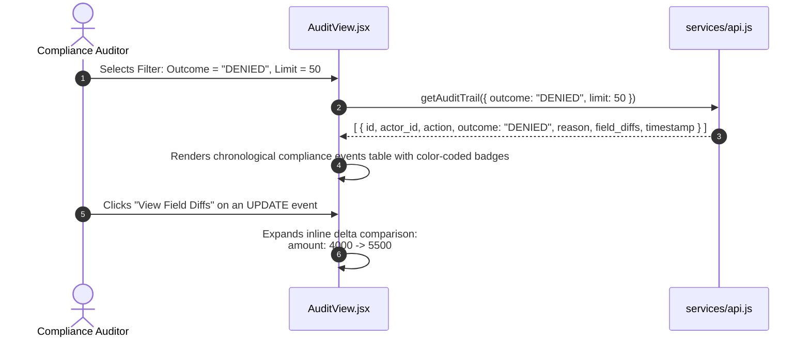

---

### 3.7 Visual Metadata Administration Studio Flow (`AdminStudio`)

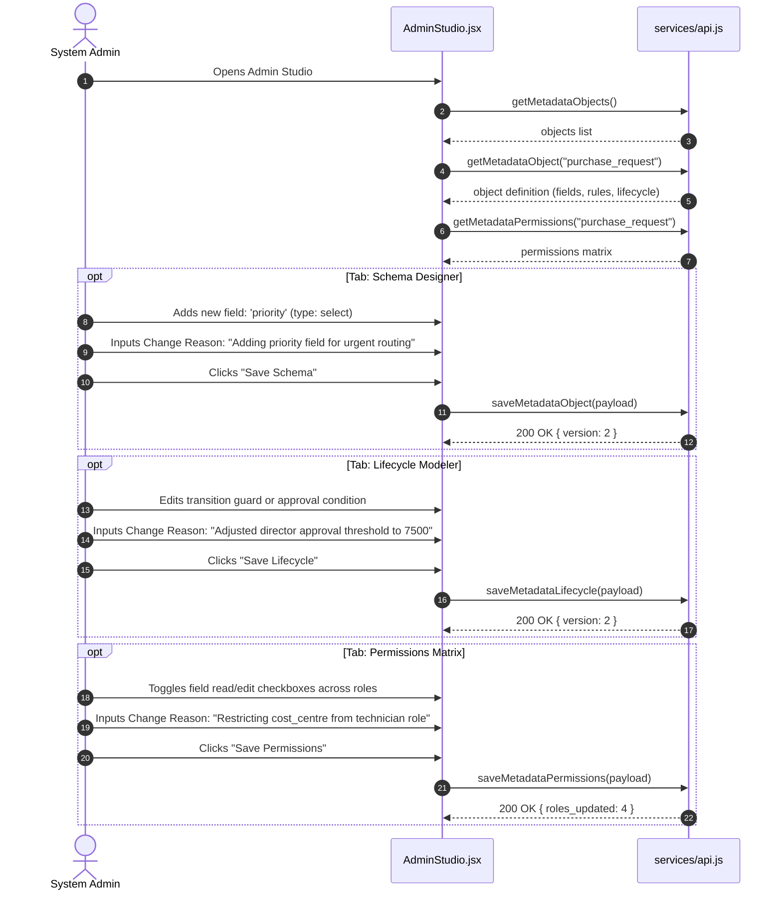

---

## 4. Master UI-to-API Mapping Matrix

The table below maps every frontend interaction to its corresponding client API service method, HTTP endpoint, backend router, downstream class methods, and database tables affected:

| # | User Action / UI Trigger | Source Component | Client Method (`services/api.js`) | HTTP Route | Headers Injected | Backend Router & Handler | Downstream Class Invocations | Database Tables Affected | Result & UI State Update |
|:---|:---|:---|:---|:---|:---|:---|:---|:---|:---|
| **1** | Select Tenant Dropdown | `ContextSwitcher.jsx` | `api.getTenantPersonas(id)` | `GET /api/tenants/{id}/personas` | None | `tenants.get_tenant_personas` | None (reads seed file) | None | Personas dropdown updated |
| **2** | Select Persona Dropdown | `ContextSwitcher.jsx` | `api.getMetadataObjects()` | `GET /api/metadata/objects` | `X-Tenant-Id`<br/>`X-Persona-Role`<br/>`X-Persona-Id` | `metadata.list_metadata_objects` | `RBACService.get_permissions` | `metadata_objects`<br/>`metadata_permissions` | Sidebar dynamically repopulated with authorized objects |
| **3** | Click Entity in Sidebar | `App.jsx` | `api.getMetadataObject(type)` | `GET /api/metadata/objects/{type}` | Context Headers | `metadata.get_metadata_object` | `RBACService.get_permissions` | `metadata_objects`<br/>`metadata_lifecycles` | Entity schema, fields, and permissions loaded; table opens |
| **4** | View Records Table | `DynamicTable.jsx` | `api.getRecords(type, params)` | `GET /api/records/{type}` | Context Headers | `records.list_records` | `RBACService.get_permissions`<br/>`FieldProjector.project_read_record` | `records` | Dynamic columns populated; restricted fields stripped |
| **5** | Click "New Record" Button | `DynamicTable.jsx` | `api.getRecords(refTarget)` | `GET /api/records/{refTarget}` | Context Headers | `records.list_records` | `RBACService.get_permissions`<br/>`FieldProjector.project_read_record` | `records` | Form displays editable fields and foreign key dropdown options |
| **6** | Submit Create Record Form | `DynamicForm.jsx` | `api.createRecord(type, data)` | `POST /api/records/{type}` | Context Headers | `records.create_record` | `RBACService.can_perform`<br/>`FieldProjector.validate_and_filter_write`<br/>`RuleEvaluator.validate_record_rules`<br/>`FieldProjector.project_read_record`<br/>`AuditService.log` | `records`<br/>`record_versions`<br/>`audit_log` | New record created with version 1; switches back to list view |
| **7** | Click Record Row in Table | `DynamicTable.jsx` | `api.getRecordDetail(type, id)` | `GET /api/records/{type}/{id}` | Context Headers | `records.get_record_detail` | `RBACService.get_permissions`<br/>`FieldProjector.project_read_record` | `records`<br/>`record_versions`<br/>`approval_requests` | Displays field grid, version history timeline, and transition buttons |
| **8** | Save Inline Edit Form | `RecordDetail.jsx` | `api.updateRecord(type, id, data)` | `PUT /api/records/{type}/{id}` | Context Headers | `records.update_record` | `RBACService.can_perform`<br/>`FieldProjector.validate_and_filter_write`<br/>`RuleEvaluator.validate_record_rules`<br/>`compute_field_diff`<br/>`AuditService.log` | `records`<br/>`record_versions`<br/>`audit_log` | Version incremented; field deltas appended to audit trail |
| **9** | Click Transition Action Button | `RecordDetail.jsx` | `api.triggerTransition(id, name)` | `POST /api/records/{id}/transitions` | Context Headers | `transitions.trigger_transition` | `WorkflowEngine.execute_transition`<br/>`RuleEvaluator.evaluate`<br/>`AuditService.log` | `records`<br/>`record_versions`<br/>`approval_requests`<br/>`audit_log` | State advances or pending approval banner appears |
| **10**| Click Approvals Tab in Navbar| `App.jsx` | `api.getPendingApprovals()` | `GET /api/approvals/pending` | Context Headers | `approvals.list_pending_approvals` | Queries role-matched requests | `approval_requests`<br/>`records` | Inbox displays pending requests matching user's role |
| **11**| Submit Approval / Rejection | `ApprovalsView.jsx` | `api.submitApprovalDecision(id, d, r)`| `POST /api/approvals/{id}/decision` | Context Headers | `approvals.submit_approval_decision`| `WorkflowEngine.execute_approval_decision`<br/>`BEGIN IMMEDIATE`<br/>`AuditService.log` | `approval_requests`<br/>`records`<br/>`record_versions`<br/>`audit_log` | Approval resolved; record transitions to Approved/Rejected |
| **12**| Click Analytics Tab | `App.jsx` | `api.getDashboardMetrics(id)` | `GET /api/dashboards/{id}` | Context Headers | `dashboards.get_dashboard_metrics` | `RBACService.get_permissions`<br/>`FieldProjector.can_read_fields`<br/>`AuditService.log` | `dashboards`<br/>`records`<br/>`audit_log` | KPI cards and charts render; restricted metrics display lock badge |
| **13**| Click Audit Trail Tab | `App.jsx` | `api.getAuditTrail(params)` | `GET /api/audit` | Context Headers | `audit.list_audit_trail` | Queries filtered log entries | `audit_log` | Compliance audit explorer populated with expandable diffs |
| **14**| Save Schema in Admin Studio | `AdminStudio.jsx` | `api.saveMetadataObject(payload)` | `POST /api/metadata/objects` | Context Headers | `metadata.save_metadata_object` | Destructive wipeout check<br/>Transition guard dependency check<br/>`AuditService.log` | `metadata_objects`<br/>`audit_log` | Schema updated live; version incremented |
| **15**| Save Lifecycle in Admin Studio| `AdminStudio.jsx` | `api.saveMetadataLifecycle(payload)` | `POST /api/metadata/lifecycles` | Context Headers | `metadata.save_metadata_lifecycle`| `AuditService.log` | `metadata_lifecycles`<br/>`audit_log` | FSM transitions updated live |
| **16**| Save Permissions Matrix | `AdminStudio.jsx` | `api.saveMetadataPermissions(payload)`| `POST /api/metadata/permissions` | Context Headers | `metadata.save_metadata_permissions`| `AuditService.log` | `metadata_permissions`<br/>`audit_log` | Role-based CRUD and field read/edit matrix updated live |

---

## 5. End-to-End User Journey Sequence Diagrams

### Journey A: Procurement Workflow (Alice submits $\rightarrow$ Bob approves $\rightarrow$ Dave orders)

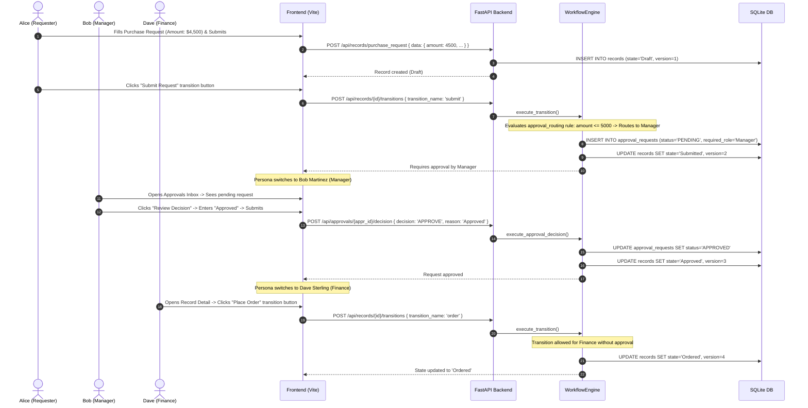

---

### Journey B: Facilities Emergency Repair (Tom reports job $\rightarrow$ Skips approval $\rightarrow$ Executes)

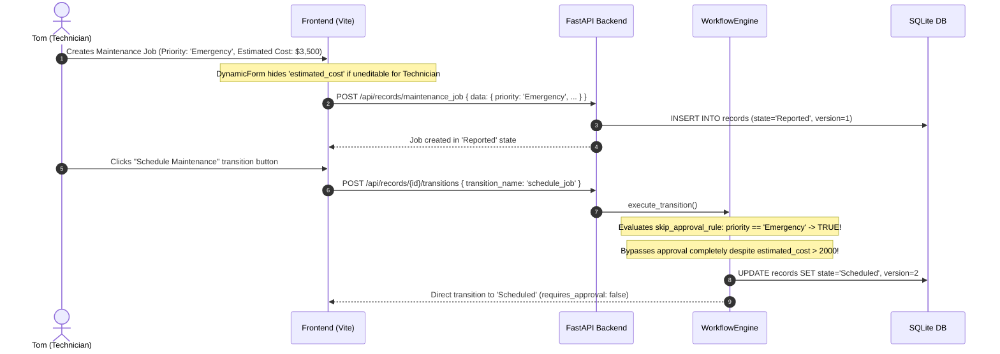
