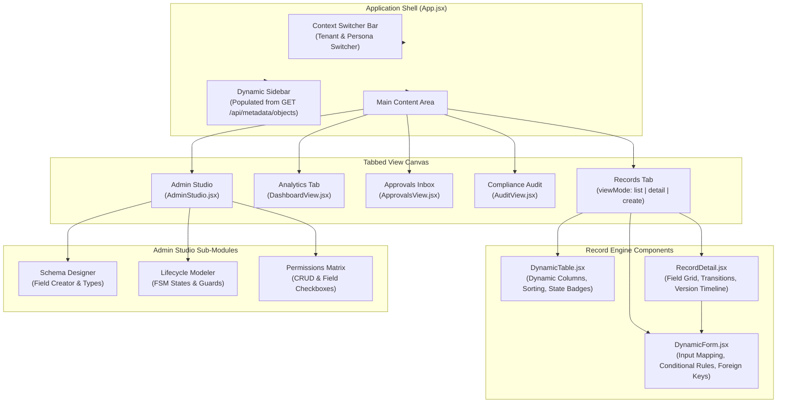

# Frontend Architecture & Technical Deep-Dive

The **Metadata-Driven Governed Workflow Platform** frontend is a universal, domain-agnostic client application built with **React 18**, **Vite**, and **Tailwind CSS**.

The foundational architectural guarantee of the client is **zero domain-specific code**: there are zero hardcoded screens, entity forms, column headers, or domain models (such as `Vendor`, `PurchaseRequest`, `Asset`, or `MaintenanceJob`) anywhere in the frontend codebase. Instead, the UI dynamically interprets and renders schemas, layouts, workflows, permissions, and dashboards delivered by the backend API.

---

## Table of Contents
1. [Component Topology & UI Architecture](#1-component-topology--ui-architecture)
2. [API Service Layer & Header Interceptors (`api.js`)](#2-api-service-layer--header-interceptors-apijs)
3. [Application Shell & Navigation Engine (`App.jsx`)](#3-application-shell--navigation-engine-appjsx)
4. [Multi-Tenant Context & Persona Switcher (`ContextSwitcher.jsx`)](#4-multi-tenant-context--persona-switcher-contextswitcherjsx)
5. [Dynamic Metadata Form Builder (`DynamicForm.jsx`)](#5-dynamic-metadata-form-builder-dynamicformjsx)
6. [Universal Dynamic Data Table (`DynamicTable.jsx`)](#6-universal-dynamic-data-table-dynamictablejsx)
7. [Record Inspector & Historical Timeline (`RecordDetail.jsx`)](#7-record-inspector--historical-timeline-recorddetailjsx)
8. [Governance Approvals Inbox (`ApprovalsView.jsx`)](#8-governance-approvals-inbox-approvalsviewjsx)
9. [Dynamic Analytics & KPI Dashboard (`DashboardView.jsx`)](#9-dynamic-analytics--kpi-dashboard-dashboardviewjsx)
10. [Compliance & Forensics Audit Explorer (`AuditView.jsx`)](#10-compliance--forensics-audit-explorer-auditviewjsx)
11. [Visual Metadata Administration Studio (`AdminStudio.jsx`)](#11-visual-metadata-administration-studio-adminstudiojsx)

---

## 1. Component Topology & UI Architecture

The frontend is structured into a clean component hierarchy where metadata cascades downwards and user actions trigger server-authoritative mutations:



---

## 2. API Service Layer & Header Interceptors (`api.js`)

File: [api.js](file:///Users/dhruvsharma/Drive/Others/Assignment/Metadata-Driven%20Governed%20Workflow%20Platform/frontend/src/services/api.js)

The API service layer acts as the centralized gateway between the React client and the backend. It guarantees that every single request transmits the active multi-tenant and persona context.

### 2.1 Dynamic Context Header Injection (`getHeaders`)
GovFlow stores the active tenant and persona selection in the browser's `localStorage`. Before dispatching any HTTP request, `getHeaders()` reads this state and synthesizes the required HTTP headers:

```javascript
export const getHeaders = () => {
  const tenantId = localStorage.getItem("active_tenant_id") || "procurement";
  const personaRole = localStorage.getItem("active_persona_role") || "Requester";
  const personaId = localStorage.getItem("active_persona_id") || "alice_req";

  return {
    "Content-Type": "application/json",
    "X-Tenant-Id": tenantId,
    "X-Persona-Role": personaRole,
    "X-Persona-Id": personaId,
  };
};
```

### 2.2 Client Methods Catalog
The `api` export provides strongly organized, asynchronous wrapper methods:

| Category | Method | Target Endpoint | Description |
|:---|:---|:---|:---|
| **Tenants & Personas** | `getTenants()` | `GET /api/tenants` | Fetches registered tenants |
| | `getTenantPersonas(tenantId)` | `GET /api/tenants/{tenantId}/personas` | Fetches personas for switcher |
| **Metadata Studio** | `getMetadataObjects()` | `GET /api/metadata/objects` | Lists objects authorized for persona |
| | `getMetadataObject(objectType)` | `GET /api/metadata/objects/{type}` | Fetches schema, rules, lifecycle |
| | `saveMetadataObject(payload)` | `POST /api/metadata/objects` | Creates/updates schema (Admin) |
| | `getMetadataLifecycle(objectType)`| `GET /api/metadata/lifecycles/{type}` | Fetches FSM definition |
| | `saveMetadataLifecycle(payload)` | `POST /api/metadata/lifecycles` | Updates FSM transitions (Admin) |
| | `getMetadataPermissions(type)` | `GET /api/metadata/permissions/{type}` | Fetches full RBAC matrix |
| | `saveMetadataPermissions(payload)`| `POST /api/metadata/permissions` | Updates permissions matrix (Admin)|
| **Records Engine** | `getRecords(objectType, params)` | `GET /api/records/{type}` | Paginated record listing |
| | `getRecordDetail(type, recordId)` | `GET /api/records/{type}/{id}` | Deep record view with versions |
| | `createRecord(objectType, data)` | `POST /api/records/{type}` | Creates new record instance |
| | `updateRecord(type, id, data)` | `PUT /api/records/{type}/{id}` | Updates record data |
| | `deleteRecord(type, id)` | `DELETE /api/records/{type}/{id}` | Soft-deletes a record |
| **Workflow Engine** | `triggerTransition(id, name)` | `POST /api/records/{id}/transitions` | Triggers FSM state transition |
| **Approvals Broker** | `getPendingApprovals()` | `GET /api/approvals/pending` | Lists pending approval tasks |
| | `submitApprovalDecision(id, d, r)`| `POST /api/approvals/{id}/decision` | Submits Approve/Reject with reason|
| **Analytics** | `getDashboards()` | `GET /api/dashboards` | Lists available dashboards |
| | `getDashboardMetrics(id)` | `GET /api/dashboards/{id}` | Fetches computed widget metrics |
| **Compliance Audit** | `getAuditTrail(params)` | `GET /api/audit` | Queries immutable compliance logs |

### 2.3 Unified Error Extraction
All mutating methods intercept non-2xx HTTP responses, extract the backend's JSON `detail` error message, and throw standard JavaScript errors that components present directly to the user:
```javascript
if (!res.ok) throw new Error((await res.json()).detail || "Failed to process request");
```

---

## 3. Application Shell & Navigation Engine (`App.jsx`)

File: [App.jsx](file:///Users/dhruvsharma/Drive/Others/Assignment/Metadata-Driven%20Governed%20Workflow%20Platform/frontend/src/App.jsx)

`App.jsx` serves as the root orchestrator. It manages the global application state, coordinates context changes, and renders the layout shell.

### 3.1 Global State Model
```javascript
const [objects, setObjects] = useState([]);               // Available metadata entities
const [selectedObjectType, setSelectedObjectType] = useState(null); // Active entity type
const [selectedObjectMeta, setSelectedObjectMeta] = useState(null); // Full entity definition
const [activeTab, setActiveTab] = useState("records");     // "records" | "dashboard" | "approvals" | "audit" | "admin"
const [viewMode, setViewMode] = useState("list");         // "list" | "detail" | "create"
const [selectedRecordId, setSelectedRecordId] = useState(null);   // ID for detail view
const [pendingApprovalsCount, setPendingApprovalsCount] = useState(0); // Badge counter
const [loading, setLoading] = useState(true);
```

### 3.2 Dynamic Navigation Generation
The sidebar navigation is **completely dynamic**:
1. When the tenant or persona changes, `loadMetadata()` calls `api.getMetadataObjects()`.
2. The sidebar dynamically iterates over `objects` and renders navigation buttons for each authorized entity (e.g. `Vendor`, `Purchase Request` under Procurement, or `Asset`, `Maintenance Job` under Facilities).
3. System tabs are conditionally presented:
   - **Records**: Active record workspace.
   - **Analytics & KPIs**: Dashboard analytics.
   - **Approvals Inbox**: Displays a real-time badge count (`pendingApprovalsCount`) showing how many requests await the current user's review.
   - **Audit Trail**: Enterprise compliance logs.
   - **Admin Studio**: Only displayed when `currentRole === "Admin"`.

### 3.3 Context Transition Handling
When a user switches tenant or persona via the top header bar, `App.jsx` handles the event seamlessly:
- Resets `viewMode` to `"list"`.
- Clears `selectedRecordId`.
- Re-fetches the object list and active metadata definition.
- Refreshes the pending approvals count for the new persona.

---

## 4. Multi-Tenant Context & Persona Switcher (`ContextSwitcher.jsx`)

File: [ContextSwitcher.jsx](file:///Users/dhruvsharma/Drive/Others/Assignment/Metadata-Driven%20Governed%20Workflow%20Platform/frontend/src/components/ContextSwitcher.jsx)

The context switcher is a sticky header bar at the top of the interface. It allows users, evaluators, and auditors to test multi-tenant boundaries and role segregation in real time without signing out.

### 4.1 State & Storage Synchronization
The switcher manages:
- `activeTenant`: Active tenant ID (`procurement`, `facilities`).
- `activePersonaId`: Active actor ID (`alice_req`, `bob_mgr`, `carol_dir`, `tom_tech`, etc.).
- `activeRole`: Active persona role (`Requester`, `Manager`, `Director`, `Finance`, `Technician`, `Facilities Lead`, `Admin`).

When a user selects a different tenant:
1. `handleTenantChange` persists `active_tenant_id` to `localStorage`.
2. Queries `api.getTenantPersonas(newTenantId)`.
3. Selects the first persona belonging to that tenant.
4. Updates `active_persona_id`, `active_persona_role`, and `active_persona_name` in `localStorage`.
5. Emits `onContextChange()` to notify the parent application to refresh all metadata and data.

### 4.2 Visual Badging & Role Attribution
The header displays:
- **Tenant Selector**: Dropdown showing available enterprise domains.
- **Persona Selector**: Dropdown showing available personas within the active tenant.
- **Current Role Pill**: Color-coded badge indicating the role:
  - Indigo for `Requester` / `Technician`
  - Purple for `Manager` / `Facilities Lead`
  - Amber for `Director`
  - Emerald for `Finance`
  - Red for `Admin`

---

## 5. Dynamic Metadata Form Builder (`DynamicForm.jsx`)

File: [DynamicForm.jsx](file:///Users/dhruvsharma/Drive/Others/Assignment/Metadata-Driven%20Governed%20Workflow%20Platform/frontend/src/components/DynamicForm.jsx)

`DynamicForm.jsx` is the core data-entry engine. It constructs forms dynamically based on the object's `schema_definition` without any pre-baked forms or hardcoded inputs.

### 5.1 Dynamic Input Field Dispatch
The component loops through `fields` and dispatches input widgets based on `field.type`:

| Field Type | Rendered Widget | Attributes Handled |
|:---|:---|:---|
| `text` | `<input type="text">` | `placeholder`, `required`, `value` |
| `number` | `<input type="number">` | `step="any"`, numeric parsing, `required` |
| `date` | `<input type="date">` | ISO `YYYY-MM-DD` formatting, `required` |
| `select` | `<select>` | Maps options array to `<option>` tags, default placeholder |
| `checkbox` | `<input type="checkbox">` | Toggle switch with boolean checked binding |
| `reference` | `<select>` | Dynamic foreign-key lookup dropdown populated via API |

### 5.2 Dynamic Foreign-Key Reference Resolution
When a field is of type `reference` (e.g., `vendor_id` referencing `vendor`, or `asset_id` referencing `asset`):
1. `useEffect` scans the schema for fields with `field.type === "reference"`.
2. Queries `api.getRecords(field.reference_target, { limit: 50 })`.
3. Populates `referenceOptions[field.name]` with real records from that entity within the same tenant.
4. Renders a select dropdown displaying the record's primary label or name:
   ```jsx
   <select value={formData[field.name] || ""} onChange={(e) => handleChange(field.name, e.target.value)}>
     <option value="">Select {field.label}...</option>
     {referenceOptions[field.name]?.map((item) => (
       <option key={item.id} value={item.id}>
         {item.data?.name || item.data?.title || item.id}
       </option>
     ))}
   </select>
   ```

### 5.3 Client-Side Dynamic Visibility Engine
Fields can specify `conditional_visibility` rules (for example: showing `permit_reference` only when `requires_permit == true`):

```javascript
const isFieldVisible = (field) => {
  if (!field.conditional_visibility) return true;
  const { field: depField, operator, value: targetVal } = field.conditional_visibility;
  const currentVal = formData[depField];
  
  if (operator === "==" || operator === "eq") return currentVal === targetVal;
  if (operator === "!=" || operator === "ne") return currentVal !== targetVal;
  if (operator === ">") return Number(currentVal) > Number(targetVal);
  if (operator === ">=") return Number(currentVal) >= Number(targetVal);
  if (operator === "<") return Number(currentVal) < Number(targetVal);
  if (operator === "<=") return Number(currentVal) <= Number(targetVal);
  if (operator === "truthy") return Boolean(currentVal);
  return true;
};
```
If `isFieldVisible(field)` returns `false`, the input control is cleanly removed from the DOM.

### 5.4 Respecting Field Permissions (`can_edit`)
On record creation and editing, `DynamicForm` inspects the permission annotations provided by the backend:
```javascript
const editableFields = fields.filter((f) => f.can_edit !== false);
```
Fields that the persona cannot edit are excluded from form inputs, preventing accidental unauthorized write attempts.

---

## 6. Universal Dynamic Data Table (`DynamicTable.jsx`)

File: [DynamicTable.jsx](file:///Users/dhruvsharma/Drive/Others/Assignment/Metadata-Driven%20Governed%20Workflow%20Platform/frontend/src/components/DynamicTable.jsx)

The `DynamicTable` component renders paginated, searchable, and sortable record listings for any entity.

### 6.1 Dynamic Column Derivation
Columns are not hardcoded. Instead, they are generated dynamically from the schema definition:
- Displays entity fields where `field.can_read !== false`.
- Automatically appends standard governance columns:
  - **State**: Current lifecycle status.
  - **Version**: Version number counter (`v1`, `v2`, etc.).
  - **Created By**: Actor attribution.
  - **Created At**: Timestamp.
  - **Actions**: "View Details" navigation button.

### 6.2 Zero-Leakage Projection Handling
If a field is restricted for the current user (e.g. `cost_centre` for `Requester`, or `estimated_cost` for `Technician`), the backend strips it from the API payload. `DynamicTable` handles this gracefully:
- It only renders columns for readable fields.
- Hidden fields never appear as empty table headers or broken cells.

### 6.3 Lifecycle Status Badge Styling
Status badges are styled with contextual colors:
| Status | Badge Color | Meaning |
|:---|:---|:---|
| `Draft` | Slate / Gray | Editable initial draft |
| `Submitted`, `Scheduled` | Amber / Yellow | Awaiting review or execution |
| `In Progress`, `Ordered` | Indigo / Blue | Active workflow execution |
| `Approved`, `Done` | Emerald / Green | Successfully completed terminal state |
| `Rejected`, `Cancelled` | Rose / Red | Denied or cancelled terminal state |

### 6.4 Client Search & Server State Filtering
- **State Filter Dropdown**: Queries records matching a specific lifecycle state (`Draft`, `Submitted`, etc.).
- **Search Bar**: Client-side full-text search across all rendered dynamic field values.
- **Sorting**: Toggle sorting between `created_at`, `updated_at`, `state`, and `version`.
- **Pagination**: Back / Next pagination buttons with total record count display.

---

## 7. Record Inspector & Historical Timeline (`RecordDetail.jsx`)

File: [RecordDetail.jsx](file:///Users/dhruvsharma/Drive/Others/Assignment/Metadata-Driven%20Governed%20Workflow%20Platform/frontend/src/components/RecordDetail.jsx)

`RecordDetail` provides an exhaustive view of a specific record, its governance state, available transitions, historical versions, and audit logs.

### 7.1 Field Value Presentation Grid
- Presents dynamic entity fields in a responsive two-column grid.
- Formats values cleanly (e.g. currency symbols for amounts/costs, formatted dates, and boolean badges).

### 7.2 Pending Governance Approval Banner
If a record has an active pending approval in `approval_requests`:
- Renders a prominent amber notification banner at the top of the card.
- Displays:
  - Target transition name and state.
  - Requester who initiated the submission.
  - Required approver role.
- **Self-Approval Refusal Handling**:
  - If the active user is the requester (`can_approve === false`), the banner displays an alert:
    *“You cannot approve this request because you submitted it (Self-approval is blocked).”*
  - If the active user matches the required role and is not the requester, the banner displays an **"Approve / Reject Decision"** action button.

### 7.3 Dynamic Lifecycle Transition Buttons
The component evaluates the record's current state and available transitions from `objectMeta.lifecycle.transitions`:
- Matches transitions where `t.from_state === record.state`.
- Verifies that the user's role is in `t.allowed_roles` (or `Admin`).
- Renders an action button for each valid transition (e.g., "Submit Request", "Place Order", "Schedule Maintenance").
- Clicking the button dispatches `api.triggerTransition(recordId, transitionName)` and refreshes the record.

### 7.4 Historical Version Timeline
A dedicated "Version History" tab displays an immutable audit timeline of point-in-time snapshots:
- Lists each version in reverse chronological order (`v3`, `v2`, `v1`).
- Shows the state of the record at that version, the actor who made the change (`changed_by`), and the timestamp.
- Displays a clean key-value breakdown of data fields captured at that exact moment in time.
- **Zero-Leakage Guarantee**: Restricted fields are stripped from historical snapshots on the server, guaranteeing that past values of restricted fields are never exposed.

---

## 8. Governance Approvals Inbox (`ApprovalsView.jsx`)

File: [ApprovalsView.jsx](file:///Users/dhruvsharma/Drive/Others/Assignment/Metadata-Driven%20Governed%20Workflow%20Platform/frontend/src/components/ApprovalsView.jsx)

The approvals view acts as a centralized governance inbox for decision-makers (Managers, Directors, Facilities Leads, and Admins).

### 8.1 Role Scoping & Pending List
- Calls `api.getPendingApprovals()`.
- The backend automatically scopes results so that non-admins only see pending items requiring their specific role.
- Renders a table detailing:
  - Record ID & Entity Type.
  - Requester who submitted the request.
  - Required role.
  - Submission timestamp.
  - Action button.

### 8.2 Self-Approval Prevention UX
If the current user is the requester of a pending item (e.g., a Manager who created a purchase request that routed to Manager approval):
- The `Review Decision` button is disabled.
- An alert badge displays: `Self-Approval Blocked`.

### 8.3 Approval / Rejection Decision Modal
Clicking "Review Decision" opens a modal dialog:
- Displays target transition and record context.
- Radio / button toggle between **Approve** (green) and **Reject** (red).
- **Mandatory Justification Input**: Approvers can provide an explanatory note (e.g., *"Budget approved for Q4"* or *"Quote exceeds departmental threshold"*).
- Dispatches `api.submitApprovalDecision(approvalId, decision, reason)` with atomic transaction safety.

---

## 9. Dynamic Analytics & KPI Dashboard (`DashboardView.jsx`)

File: [DashboardView.jsx](file:///Users/dhruvsharma/Drive/Others/Assignment/Metadata-Driven%20Governed%20Workflow%20Platform/frontend/src/components/DashboardView.jsx)

`DashboardView` renders operational analytics strictly from declarative JSON metadata defined in the `dashboards` table.

### 9.1 Supported Widget Types
The dashboard engine dynamically interprets three widget types:
1. **KPI Cards (`type: "kpi"`)**:
   - Computes single-value metrics (`count`, `sum`, or `avg`).
   - Renders a large metric value with descriptive label and aggregation badge.
2. **Distribution Charts (`type: "chart"`)**:
   - Aggregates records by a `group_by` field (e.g. `state` or dynamic fields).
   - Renders a responsive horizontal distribution bar chart displaying category labels, values, and percentage bars.
3. **Summary Tables (`type: "table"`)**:
   - Renders a compact summary table of the most recent records with server-projected data.

### 9.2 Zero-Leakage Anti-Leakage Badges (`RESTRICTED` Handling)
If a widget aggregates or groups by a field that is hidden from the user's role (for example, a KPI summing `estimated_cost` viewed by a `Technician`, or grouping by `cost_centre` viewed by a `Requester`):
- The backend refuses to compute the metric and returns:
  ```json
  {"status": "RESTRICTED", "error": "This metric is hidden because it aggregates or groups by restricted fields."}
  ```
- `DashboardView` catches this status and renders a dedicated **Restricted Access Card**:
  - Displays a lock icon (`Lock` from Lucide).
  - Explains why the metric is barred.
  - **Zero leakage**: The card contains zero numeric values, zero totals, and zero category distributions, completely preventing inference attacks.

---

## 10. Compliance & Forensics Audit Explorer (`AuditView.jsx`)

File: [AuditView.jsx](file:///Users/dhruvsharma/Drive/Others/Assignment/Metadata-Driven%20Governed%20Workflow%20Platform/frontend/src/components/AuditView.jsx)

`AuditView` provides security officers and administrators with a forensic audit explorer querying the append-only `audit_log` table.

### 10.1 Multi-Criteria Filter Bar
Allows filtering the audit trail by:
- **Entity Type**: Filter by specific object (e.g., `purchase_request`, `maintenance_job`).
- **Outcome**: Filter by result:
  - `SUCCESS`: Authorized operations.
  - `DENIED`: Access control or self-approval blocks.
  - `CONFLICT`: Concurrency race condition attempts.
  - `GUARD_FAILED`: Transition guard expression failures.
  - `FAILED_VALIDATION`: Cross-field validation rejections.
- **Record ID**: Direct lookup of a specific record's compliance trail.
- **Query Limit**: 25, 50, or 100 entries.

### 10.2 Outcome Visual Indicators
Each event is marked with an outcome pill:
- Emerald for `SUCCESS`
- Red for `DENIED`
- Amber for `CONFLICT`
- Orange for `GUARD_FAILED` and `FAILED_VALIDATION`

### 10.3 Granular JSON Diff Viewer
When an audit entry contains field modifications (`field_diffs`):
- Clicking "View Field Diffs" expands a granular delta comparison:
  ```
  amount: 4000  →  4500
  justification: "Old justification"  →  "Updated justification"
  ```
- Allows forensic review of exact property mutations across versions.

---

## 11. Visual Metadata Administration Studio (`AdminStudio.jsx`)

File: [AdminStudio.jsx](file:///Users/dhruvsharma/Drive/Others/Assignment/Metadata-Driven%20Governed%20Workflow%20Platform/frontend/src/components/AdminStudio.jsx)

The `AdminStudio` provides a no-code visual configuration studio for system administrators to customize or introduce new business objects, lifecycle state machines, and permission matrices live without deploying code.

### 11.1 Sub-Module Tabs
The studio is partitioned into three visual tabs:

#### 1. Schema Designer (`studioTab === "schema"`)
- Displays an entity's active fields, data types, required flags, and display orders.
- **Field Creator**:
  - Field Name (system identifier) and Field Label (display name).
  - Type Selector: `text`, `number`, `date`, `select`, `checkbox`, `reference`.
  - For `reference` types: target entity dropdown.
  - For `select` types: comma-separated options list.
  - Required checkbox.
- Allows appending new fields or removing fields with immediate visual feedback.

#### 2. Lifecycle & FSM Builder (`studioTab === "lifecycle"`)
- Visualizes allowed lifecycle states (`states` array).
- Visualizes transitions with `from_state`, `to_state`, `allowed_roles`, and `requires_approval` toggles.
- Displays approval routing rules and guard expressions.

#### 3. Permissions Matrix Editor (`studioTab === "permissions"`)
- Visual spreadsheet-style matrix table displaying all tenant roles on rows.
- **Object-Level CRUD Toggles**: Checkboxes for `Create`, `Read`, `Update`, and `Delete`.
- **Field-Level Security Matrix**: For each schema field, provides independent `Read` and `Edit` checkboxes per role.
- Allows administrators to visually grant or revoke field-level visibility live.

### 11.2 Mandatory Administrative Change Justification
In enterprise governance, arbitrary or unrecorded configuration changes represent a compliance violation.
- Every save operation in `AdminStudio` requires entering a **Change Reason / Justification Comment** (`changeReason`).
- If the comment is missing or shorter than 10 characters, the studio blocks the save and alerts the administrator:
  *“Mandatory administrative reason required (minimum 10 characters).”*
- When submitted, the reason is permanently stamped in the system `audit_log`.
