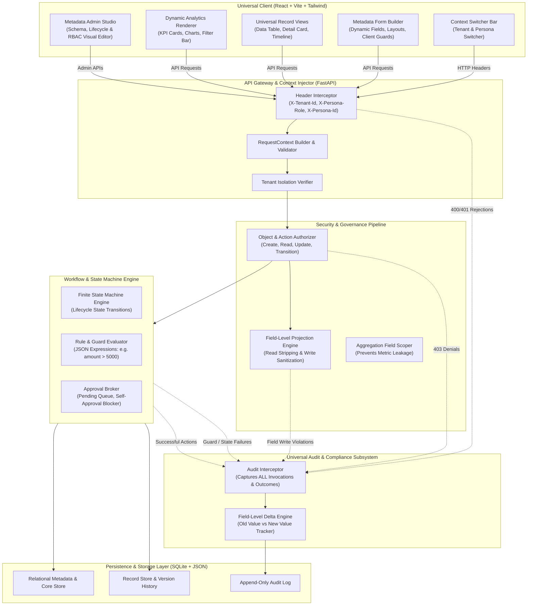
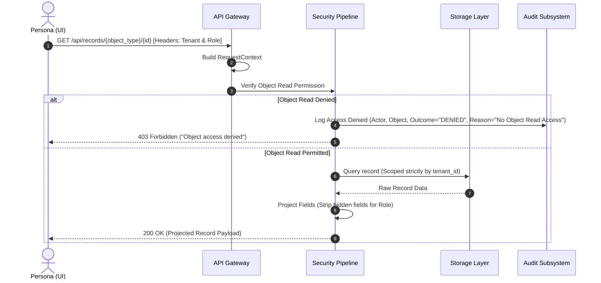
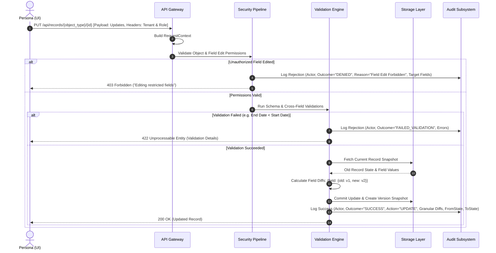
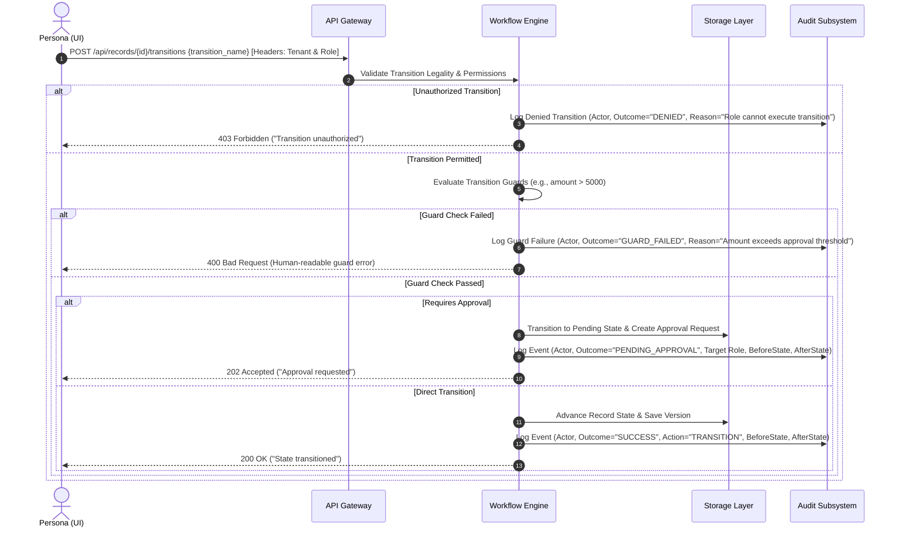
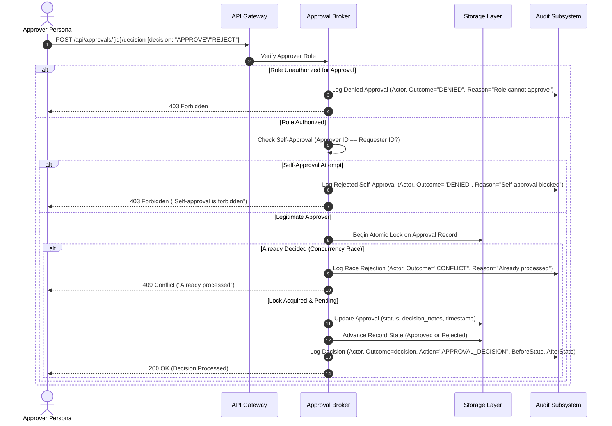

# High-Level System Design (HLSD)
## Metadata-Driven Governed Workflow Platform

---

## 1. Executive Summary & Core Architectural Goals

The **Metadata-Driven Governed Workflow Platform** is an enterprise-grade, domain-agnostic, multi-tenant application where every business entity, data schema, UI layout, lifecycle transition, authorization rule, approval constraint, and dashboard widget is defined via declarative JSON metadata.

### 1.1 Core Tenets & Architectural Guarantees
1. **Zero Domain-Specific Code**: Neither the backend nor the frontend contains a single hardcoded reference to any specific domain (e.g., zero occurrences of `Vendor`, `Purchase Request`, `Asset`, or `Maintenance Job`). Introducing a third business domain requires **zero code changes or deployments**—strictly new metadata seeds.
2. **Server-Authoritative Governance**: The UI is purely an adaptive projection. All access control checks, field visibility projections, state transition guard evaluations, and approval constraints are enforced strictly on the server.
3. **Ironclad Multi-Tenant Isolation**: Multi-tenancy is enforced at the API Gateway and query layers. One tenant can never access, query, or leak data into another tenant.
4. **Zero-Leakage Field-Level Security**: If a persona is not granted read access to a field, that field is stripped server-side from all record payloads and is strictly excluded from aggregate/dashboard calculations.
5. **Universal & Granular Audit Logging**: Every single event—whether accepted, rejected, forbidden, or failed due to validation—is intercepted and recorded in an immutable audit store. Logs capture actor attribution, target object, state transition, and a granular field-level diff (`old_value` vs `new_value`).
6. **Concurrent State & Approval Safety**: State transitions and approvals employ atomic transactions to prevent double-approval race conditions and enforce self-approval blocking.

---

## 2. High-Level Component Architecture

---

## 3. Component Responsibilities & Separation of Concerns

### 3.1 Universal UI Layer
- **Domain Independence**: Renders screens entirely from metadata payloads delivered by the backend.
- **Dynamic Form Renderer**: Constructs input controls (text, number, date, select, checkbox, reference lookups) based on field definitions and handles client-side dynamic visibility.
- **Universal Data & Detail Views**: Renders sortable, filterable tables and record detail views with state badges, transition buttons, pending approval banners, and chronological history timelines.
- **Persona & Tenant Switcher**: Facilitates instant testing by toggling tenant and persona headers sent on all requests.

### 3.2 API Gateway & Context Injector Layer
- **Header Parsing**: Extracts `X-Tenant-Id`, `X-Persona-Role`, and `X-Persona-Id`.
- **Context Injection**: Produces an immutable, request-scoped context containing tenant and actor details.
- **Fail-Closed Boundary**: Immediately blocks and logs any request lacking valid tenant or persona credentials.

### 3.3 Security & Governance Pipeline
- **Object-Level RBAC**: Evaluates whether the caller's role is authorized to perform `create`, `read`, `update`, `delete`, or `transition` on the target object.
- **Field-Level Projection**:
  - **Read**: Strips all fields from API responses where the role lacks read permission.
  - **Write**: Drops or rejects writes targeting fields where the role lacks edit permission.
  - **Analytics**: Validates that metric and grouping fields are readable by the caller before calculating dashboard metrics.

### 3.4 Workflow & State Machine Engine
- **Lifecycle FSM**: Validates allowed state transitions per object definition.
- **Guard Rule Engine**: Evaluates JSON-based conditional guard expressions against record fields and actor context.
- **Approval Broker**: Manages pending approvals, enforces atomic approval decisions, and prevents self-approvals.

### 3.5 Universal Audit & Compliance Subsystem
- **Comprehensive Capture**: Enforces that **every** outcome—acceptance, user rejection, permission denial, validation failure, and guard failure—is permanently logged.
- **Granular Delta Tracking**: Computes field-level changes showing the previous and new value for every modified field, along with before and after state snapshots.
- **Audit Tamper-Resistance**: Append-only design with no update or delete access.

---

## 4. End-to-End Request Data Flows (With Comprehensive Audit Logging)

### 4.1 Record Read & Dashboard Aggregation Flow

### 4.2 Record Create / Update Flow (With Granular Field Diffs)

### 4.3 Lifecycle State Transition Flow

### 4.4 Approval Decision Flow (Self-Approval Blocker & Atomic Lock)

---

## 5. Granular Audit Log Contract (High-Level Model)

Every audit entry emitted across all subsystems adheres to the following unified schema:

| Field | Conceptual Definition | Example Value |
|:---|:---|:---|
| `tenant_id` | Identifier of the tenant | `"procurement"` |
| `actor_id` | Identifier of acting user | `"user_requester_1"` |
| `actor_role` | Role of actor at time of action | `"Requester"` |
| `action` | Action attempted | `"CREATE"`, `"UPDATE"`, `"TRANSITION"`, `"APPROVE"`, `"REJECT"`, `"READ"` |
| `object_type` | Target metadata object type | `"purchase_request"` |
| `record_id` | ID of the target record | `"rec_101"` |
| `outcome` | Result of invocation | `"SUCCESS"`, `"DENIED"`, `"FAILED_VALIDATION"`, `"GUARD_FAILED"`, `"CONFLICT"` |
| `reason` | Human-readable outcome or failure message | `"Self-approval is forbidden by governance policy"` |
| `before_state` | State before transition/mutation | `"Draft"` |
| `after_state` | State after transition/mutation | `"Submitted"` |
| `field_diffs` | Granular field-level changes | `{"amount": {"old": 4000, "new": 6000}}` |
| `timestamp` | UTC ISO-8601 Timestamp | `"2026-10-11T10:30:00Z"` |

---

## 6. High-Level Edge Case Mitigation Strategy

- **Field Leakage in Dashboards**: Pre-execution authorization check on analytics queries. Hidden fields are omitted from aggregations, calculations, and grouping operations.
- **Double-Approval Race Condition**: Atomic conditional database updates ensure that only the first incoming request can alter a pending approval.
- **Self-Approval Protection**: Hard invariant check comparing `actor_id` against `requester_id` regardless of granted roles.
- **Cross-Tenant & Dangling References**: Relational reference queries are strictly scoped by `tenant_id` and active status.
- **Metadata Changes on Existing Records**: Metadata schema updates are additive and non-destructive; legacy JSON payloads remain queryable without corruption.

