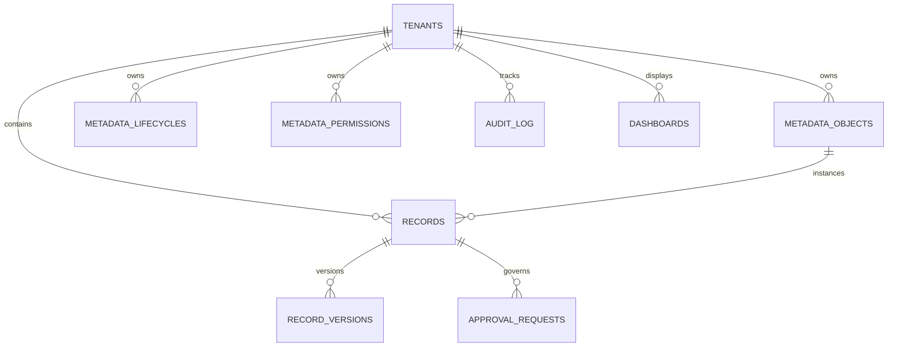

# Low-Level Design (LLD)
## Metadata-Driven Governed Workflow Platform

---

## 1. Database Schema Design (SQLite + Native JSON)

The database design strikes a balance between **strict relational constraints** (for tenants, system metadata, access control, atomic approvals, and audit trails) and **extensible JSON storage** (for dynamic record fields, validation ASTs, and layout specifications).

SQLite is initialized with `PRAGMA journal_mode = WAL;` and `PRAGMA foreign_keys = ON;`.



### 1.1 Relational DDL Specifications

```sql
-- 1. Tenants Table
CREATE TABLE tenants (
    id VARCHAR(64) PRIMARY KEY,
    name VARCHAR(255) NOT NULL,
    description TEXT,
    created_at TIMESTAMP DEFAULT CURRENT_TIMESTAMP
);

-- 2. Metadata Objects Table (Dynamic Entity Definitions)
CREATE TABLE metadata_objects (
    id VARCHAR(64) PRIMARY KEY,
    tenant_id VARCHAR(64) NOT NULL,
    object_type VARCHAR(64) NOT NULL,
    label VARCHAR(255) NOT NULL,
    description TEXT,
    schema_definition JSON NOT NULL, -- List of Field Definitions
    validation_rules JSON,           -- List of Cross-Field Rules
    version INTEGER DEFAULT 1,
    created_at TIMESTAMP DEFAULT CURRENT_TIMESTAMP,
    updated_at TIMESTAMP DEFAULT CURRENT_TIMESTAMP,
    FOREIGN KEY (tenant_id) REFERENCES tenants(id) ON DELETE CASCADE,
    UNIQUE (tenant_id, object_type)
);

-- 3. Metadata Lifecycles Table (FSM & Approval Definitions)
CREATE TABLE metadata_lifecycles (
    id VARCHAR(64) PRIMARY KEY,
    tenant_id VARCHAR(64) NOT NULL,
    object_type VARCHAR(64) NOT NULL,
    initial_state VARCHAR(64) NOT NULL,
    states JSON NOT NULL,            -- Array of allowed state strings
    transitions JSON NOT NULL,       -- Array of transition rules and guards
    version INTEGER DEFAULT 1,
    created_at TIMESTAMP DEFAULT CURRENT_TIMESTAMP,
    updated_at TIMESTAMP DEFAULT CURRENT_TIMESTAMP,
    FOREIGN KEY (tenant_id) REFERENCES tenants(id) ON DELETE CASCADE,
    UNIQUE (tenant_id, object_type)
);

-- 4. Metadata Permissions Table (RBAC Matrix)
CREATE TABLE metadata_permissions (
    id VARCHAR(64) PRIMARY KEY,
    tenant_id VARCHAR(64) NOT NULL,
    object_type VARCHAR(64) NOT NULL,
    role VARCHAR(64) NOT NULL,
    can_create BOOLEAN DEFAULT 0,
    can_read BOOLEAN DEFAULT 0,
    can_update BOOLEAN DEFAULT 0,
    can_delete BOOLEAN DEFAULT 0,
    field_permissions JSON NOT NULL,       -- {"field_name": {"read": bool, "edit": bool}}
    transition_permissions JSON NOT NULL,  -- Array of allowed transition names
    approval_permissions JSON NOT NULL,    -- Array of allowed approval transition names
    FOREIGN KEY (tenant_id) REFERENCES tenants(id) ON DELETE CASCADE,
    UNIQUE (tenant_id, object_type, role)
);

-- 5. Dynamic Records Table
CREATE TABLE records (
    id VARCHAR(64) PRIMARY KEY,
    tenant_id VARCHAR(64) NOT NULL,
    object_type VARCHAR(64) NOT NULL,
    state VARCHAR(64) NOT NULL,
    version INTEGER DEFAULT 1,
    created_by VARCHAR(64) NOT NULL,
    created_at TIMESTAMP DEFAULT CURRENT_TIMESTAMP,
    updated_by VARCHAR(64) NOT NULL,
    updated_at TIMESTAMP DEFAULT CURRENT_TIMESTAMP,
    data JSON NOT NULL,              -- Dynamic field key-value pairs
    is_deleted BOOLEAN DEFAULT 0,
    FOREIGN KEY (tenant_id) REFERENCES tenants(id) ON DELETE CASCADE
);

CREATE INDEX idx_records_lookup ON records (tenant_id, object_type, state);
CREATE INDEX idx_records_deleted ON records (tenant_id, is_deleted);

-- 6. Record Versions Table (Immutable Change History)
CREATE TABLE record_versions (
    id VARCHAR(64) PRIMARY KEY,
    tenant_id VARCHAR(64) NOT NULL,
    record_id VARCHAR(64) NOT NULL,
    version INTEGER NOT NULL,
    state VARCHAR(64) NOT NULL,
    data JSON NOT NULL,
    changed_by VARCHAR(64) NOT NULL,
    changed_at TIMESTAMP DEFAULT CURRENT_TIMESTAMP,
    FOREIGN KEY (record_id) REFERENCES records(id) ON DELETE CASCADE,
    UNIQUE (record_id, version)
);

-- 7. Approval Requests Table (Concurrency-Safe Approval Pipeline)
CREATE TABLE approval_requests (
    id VARCHAR(64) PRIMARY KEY,
    tenant_id VARCHAR(64) NOT NULL,
    record_id VARCHAR(64) NOT NULL,
    transition_name VARCHAR(64) NOT NULL,
    target_state VARCHAR(64) NOT NULL,
    requester_id VARCHAR(64) NOT NULL,
    required_role VARCHAR(64) NOT NULL,
    status VARCHAR(32) DEFAULT 'PENDING', -- 'PENDING', 'APPROVED', 'REJECTED'
    decision_by VARCHAR(64),
    decision_role VARCHAR(64),
    decision_reason TEXT,
    created_at TIMESTAMP DEFAULT CURRENT_TIMESTAMP,
    decided_at TIMESTAMP,
    FOREIGN KEY (record_id) REFERENCES records(id) ON DELETE CASCADE
);

CREATE INDEX idx_approvals_pending ON approval_requests (tenant_id, record_id, status);

-- 8. Append-Only Audit Log Table (Tamper-Resistant)
CREATE TABLE audit_log (
    id INTEGER PRIMARY KEY AUTOINCREMENT,
    tenant_id VARCHAR(64) NOT NULL,
    actor_id VARCHAR(64) NOT NULL,
    actor_role VARCHAR(64) NOT NULL,
    action VARCHAR(64) NOT NULL,        -- 'CREATE', 'UPDATE', 'TRANSITION', 'APPROVE', 'REJECT', 'DENIED_READ', etc.
    object_type VARCHAR(64) NOT NULL,
    record_id VARCHAR(64),
    outcome VARCHAR(32) NOT NULL,       -- 'SUCCESS', 'DENIED', 'FAILED_VALIDATION', 'GUARD_FAILED', 'CONFLICT'
    reason TEXT,
    before_state VARCHAR(64),
    after_state VARCHAR(64),
    field_diffs JSON,                  -- {"field_name": {"old": val, "new": val}}
    timestamp TIMESTAMP DEFAULT CURRENT_TIMESTAMP
);

CREATE INDEX idx_audit_lookup ON audit_log (tenant_id, object_type, record_id);
CREATE INDEX idx_audit_actor ON audit_log (tenant_id, actor_id);

-- 9. Dashboards & Widgets Configuration Table
CREATE TABLE dashboards (
    id VARCHAR(64) PRIMARY KEY,
    tenant_id VARCHAR(64) NOT NULL,
    title VARCHAR(255) NOT NULL,
    widgets JSON NOT NULL,             -- Array of Widget Definitions
    FOREIGN KEY (tenant_id) REFERENCES tenants(id) ON DELETE CASCADE
);
```

---

## 2. Metadata Seed Specification (Zero Domain-Specific Code)

All entity logic is decoupled into JSON seed files.

### 2.1 Tenant A: Procurement Domain Seed (`procurement.json`)
```json
{
  "tenant": {
    "id": "procurement",
    "name": "Procurement Operations"
  },
  "objects": [
    {
      "object_type": "vendor",
      "label": "Vendor",
      "schema_definition": [
        {"name": "name", "label": "Vendor Name", "type": "text", "required": true, "display_order": 1},
        {"name": "code", "label": "Vendor Code", "type": "text", "required": true, "display_order": 2},
        {"name": "contact_email", "label": "Contact Email", "type": "text", "required": false, "display_order": 3}
      ]
    },
    {
      "object_type": "purchase_request",
      "label": "Purchase Request",
      "schema_definition": [
        {"name": "amount", "label": "Amount ($)", "type": "number", "required": true, "display_order": 1},
        {"name": "needed_by", "label": "Needed By Date", "type": "date", "required": true, "display_order": 2},
        {"name": "justification", "label": "Justification", "type": "text", "required": true, "display_order": 3},
        {
          "name": "vendor_id", 
          "label": "Vendor", 
          "type": "reference", 
          "required": true, 
          "reference_target": "vendor",
          "display_order": 4
        },
        {"name": "cost_centre", "label": "Cost Centre", "type": "text", "required": false, "display_order": 5}
      ],
      "validation_rules": [
        {
          "rule_name": "positive_amount",
          "expression": {"field": "amount", "operator": ">", "value": 0},
          "error_message": "Amount must be greater than zero."
        }
      ]
    }
  ],
  "lifecycles": [
    {
      "object_type": "purchase_request",
      "initial_state": "Draft",
      "states": ["Draft", "Submitted", "Approved", "Rejected", "Ordered"],
      "transitions": [
        {
          "name": "submit",
          "from_state": "Draft",
          "to_state": "Submitted",
          "allowed_roles": ["Requester"],
          "requires_approval": true,
          "approval_routing": {
            "rule": {
              "condition": {"field": "amount", "operator": ">", "value": 5000},
              "role_if_true": "Director",
              "role_if_false": "Manager"
            }
          }
        },
        {
          "name": "order",
          "from_state": "Approved",
          "to_state": "Ordered",
          "allowed_roles": ["Requester", "Manager", "Finance"],
          "requires_approval": false
        }
      ]
    }
  ],
  "permissions": [
    {
      "object_type": "purchase_request",
      "role": "Requester",
      "can_create": true, "can_read": true, "can_update": true, "can_delete": false,
      "field_permissions": {
        "amount": {"read": true, "edit": true},
        "needed_by": {"read": true, "edit": true},
        "justification": {"read": true, "edit": true},
        "vendor_id": {"read": true, "edit": true},
        "cost_centre": {"read": false, "edit": false}
      },
      "transition_permissions": ["submit"],
      "approval_permissions": []
    },
    {
      "object_type": "purchase_request",
      "role": "Manager",
      "can_create": false, "can_read": true, "can_update": false, "can_delete": false,
      "field_permissions": {
        "amount": {"read": true, "edit": false},
        "needed_by": {"read": true, "edit": false},
        "justification": {"read": true, "edit": false},
        "vendor_id": {"read": true, "edit": false},
        "cost_centre": {"read": false, "edit": false}
      },
      "transition_permissions": ["order"],
      "approval_permissions": ["submit"]
    },
    {
      "object_type": "purchase_request",
      "role": "Director",
      "can_create": false, "can_read": true, "can_update": false, "can_delete": false,
      "field_permissions": {
        "amount": {"read": true, "edit": false},
        "needed_by": {"read": true, "edit": false},
        "justification": {"read": true, "edit": false},
        "vendor_id": {"read": true, "edit": false},
        "cost_centre": {"read": false, "edit": false}
      },
      "transition_permissions": [],
      "approval_permissions": ["submit"]
    },
    {
      "object_type": "purchase_request",
      "role": "Finance",
      "can_create": false, "can_read": true, "can_update": true, "can_delete": false,
      "field_permissions": {
        "amount": {"read": true, "edit": false},
        "needed_by": {"read": true, "edit": false},
        "justification": {"read": true, "edit": false},
        "vendor_id": {"read": true, "edit": false},
        "cost_centre": {"read": true, "edit": true}
      },
      "transition_permissions": ["order"],
      "approval_permissions": []
    }
  ],
  "dashboards": [
    {
      "id": "procurement_overview",
      "title": "Procurement Overview",
      "widgets": [
        {
          "widget_id": "kpi_total_requests",
          "title": "Total Requests",
          "type": "kpi",
          "object_type": "purchase_request",
          "metric": {"agg": "count"}
        },
        {
          "widget_id": "chart_spend_by_state",
          "title": "Spend by Lifecycle State",
          "type": "chart",
          "object_type": "purchase_request",
          "metric": {"agg": "sum", "field": "amount"},
          "group_by": "state"
        }
      ]
    }
  ]
}
```

### 2.2 Tenant B: Facilities Domain Seed (`facilities.json`)
```json
{
  "tenant": {
    "id": "facilities",
    "name": "Facilities & Maintenance"
  },
  "objects": [
    {
      "object_type": "asset",
      "label": "Facility Asset",
      "schema_definition": [
        {"name": "name", "label": "Asset Name", "type": "text", "required": true, "display_order": 1},
        {"name": "location", "label": "Building / Floor", "type": "text", "required": true, "display_order": 2}
      ]
    },
    {
      "object_type": "maintenance_job",
      "label": "Maintenance Job",
      "schema_definition": [
        {
          "name": "priority", 
          "label": "Priority", 
          "type": "select", 
          "options": ["Low", "Medium", "High", "Emergency"], 
          "required": true, 
          "display_order": 1
        },
        {"name": "scheduled_start", "label": "Scheduled Start", "type": "date", "required": true, "display_order": 2},
        {"name": "scheduled_end", "label": "Scheduled End", "type": "date", "required": true, "display_order": 3},
        {
          "name": "asset_id", 
          "label": "Asset Reference", 
          "type": "reference", 
          "required": true, 
          "reference_target": "asset", 
          "display_order": 4
        },
        {"name": "estimated_cost", "label": "Estimated Cost ($)", "type": "number", "required": true, "display_order": 5}
      ],
      "validation_rules": [
        {
          "rule_name": "end_after_start",
          "expression": {"field": "scheduled_end", "operator": ">=", "field_compare": "scheduled_start"},
          "error_message": "Scheduled end date must be on or after scheduled start date."
        }
      ]
    }
  ],
  "lifecycles": [
    {
      "object_type": "maintenance_job",
      "initial_state": "Reported",
      "states": ["Reported", "Scheduled", "In Progress", "Done", "Cancelled"],
      "transitions": [
        {
          "name": "schedule_job",
          "from_state": "Reported",
          "to_state": "Scheduled",
          "allowed_roles": ["Technician", "Facilities Lead"],
          "skip_approval_rule": {"field": "priority", "operator": "==", "value": "Emergency"},
          "requires_approval": true,
          "approval_routing": {
            "rule": {
              "condition": {"field": "estimated_cost", "operator": ">", "value": 2000},
              "role_if_true": "Facilities Lead",
              "role_if_false": "Facilities Lead"
            }
          }
        },
        {
          "name": "start_work",
          "from_state": "Scheduled",
          "to_state": "In Progress",
          "allowed_roles": ["Technician", "Facilities Lead"],
          "requires_approval": false
        },
        {
          "name": "complete_job",
          "from_state": "In Progress",
          "to_state": "Done",
          "allowed_roles": ["Technician", "Facilities Lead"],
          "requires_approval": false
        }
      ]
    }
  ],
  "permissions": [
    {
      "object_type": "maintenance_job",
      "role": "Technician",
      "can_create": true, "can_read": true, "can_update": true, "can_delete": false,
      "field_permissions": {
        "priority": {"read": true, "edit": true},
        "scheduled_start": {"read": true, "edit": true},
        "scheduled_end": {"read": true, "edit": true},
        "asset_id": {"read": true, "edit": true},
        "estimated_cost": {"read": false, "edit": false}
      },
      "transition_permissions": ["schedule_job", "start_work", "complete_job"],
      "approval_permissions": []
    },
    {
      "object_type": "maintenance_job",
      "role": "Facilities Lead",
      "can_create": true, "can_read": true, "can_update": true, "can_delete": true,
      "field_permissions": {
        "priority": {"read": true, "edit": true},
        "scheduled_start": {"read": true, "edit": true},
        "scheduled_end": {"read": true, "edit": true},
        "asset_id": {"read": true, "edit": true},
        "estimated_cost": {"read": true, "edit": true}
      },
      "transition_permissions": ["schedule_job", "start_work", "complete_job"],
      "approval_permissions": ["schedule_job"]
    }
  ],
  "dashboards": [
    {
      "id": "facilities_overview",
      "title": "Facilities Operations",
      "widgets": [
        {
          "widget_id": "kpi_active_jobs",
          "title": "Total Jobs",
          "type": "kpi",
          "object_type": "maintenance_job",
          "metric": {"agg": "count"}
        },
        {
          "widget_id": "chart_jobs_by_priority",
          "title": "Jobs by Priority",
          "type": "chart",
          "object_type": "maintenance_job",
          "metric": {"agg": "count"},
          "group_by": "priority"
        }
      ]
    }
  ]
}
```

---

## 3. Enforcement Logic & Technical Implementation

### 3.1 Field-Level Projection Engine (Zero-Leakage Enforcement)

```python
# app/security/projection.py

class FieldProjector:
    @staticmethod
    def project_read_payload(record_dict: dict, field_perms: dict[str, dict]) -> dict:
        """
        Strips any field where read permission is False or omitted.
        Guarantees that unprivileged callers receive zero evidence of the hidden field.
        """
        raw_data = record_dict.get("data", {})
        projected_data = {}
        for field_name, value in raw_data.items():
            perm = field_perms.get(field_name, {})
            if perm.get("read", False) is True:
                projected_data[field_name] = value

        clean_record = record_dict.copy()
        clean_record["data"] = projected_data
        return clean_record

    @staticmethod
    def filter_write_payload(input_data: dict, field_perms: dict[str, dict]) -> tuple[dict, list[str]]:
        """
        Detects any attempt to modify fields where edit permission is False.
        Returns the sanitized data and a list of rejected field violations.
        """
        sanitized = {}
        rejected_fields = []
        for field_name, value in input_data.items():
            perm = field_perms.get(field_name, {})
            if perm.get("edit", False) is True:
                sanitized[field_name] = value
            else:
                rejected_fields.append(field_name)
        return sanitized, rejected_fields
```

### 3.2 Declarative Rule & Guard Evaluator (AST Engine)

```python
# app/workflow/rules.py
import operator
from datetime import datetime

OPERATORS = {
    "==": operator.eq,
    "!=": operator.ne,
    ">": operator.gt,
    ">=": operator.ge,
    "<": operator.lt,
    "<=": operator.le,
    "in": lambda a, b: a in b,
    "not_in": lambda a, b: a not in b,
}

class RuleEvaluator:
    @staticmethod
    def evaluate(expression: dict, context_data: dict) -> bool:
        """
        Evaluates declarative JSON rule expressions:
        1. Simple rule: {"field": "amount", "operator": ">", "value": 5000}
        2. Cross-field rule: {"field": "scheduled_end", "operator": ">=", "field_compare": "scheduled_start"}
        3. Logical Compound: {"and": [...]}, {"or": [...]}
        """
        if "and" in expression:
            return all(RuleEvaluator.evaluate(sub, context_data) for sub in expression["and"])
        if "or" in expression:
            return any(RuleEvaluator.evaluate(sub, context_data) for sub in expression["or"])

        field = expression.get("field")
        op_str = expression.get("operator")
        op_func = OPERATORS.get(op_str)
        if not op_func:
            raise ValueError(f"Unsupported rule operator: {op_str}")

        left_val = context_data.get(field)

        # Support cross-field comparison
        if "field_compare" in expression:
            right_val = context_data.get(expression["field_compare"])
        else:
            right_val = expression.get("value")

        if left_val is None or right_val is None:
            return False

        # Normalize date strings if dates are being compared
        if isinstance(left_val, str) and isinstance(right_val, str):
            try:
                left_val = datetime.fromisoformat(left_val)
                right_val = datetime.fromisoformat(right_val)
            except ValueError:
                pass

        return op_func(left_val, right_val)
```

### 3.3 Atomic State Transitions & Concurrency-Safe Approvals

```python
# app/workflow/approvals.py
import sqlite3
from fastapi import HTTPException

class WorkflowEngine:
    def __init__(self, db_conn: sqlite3.Connection, audit_service):
        self.conn = db_conn
        self.audit = audit_service

    def execute_approval(
        self,
        tenant_id: str,
        approval_id: str,
        actor_id: str,
        actor_role: str,
        decision: str,  # "APPROVE" or "REJECT"
        reason: str = None
    ):
        """
        Executes approval decision inside an atomic SQLite transaction.
        Enforces self-approval blocks and prevents double-approval race conditions.
        """
        cursor = self.conn.cursor()
        
        # 1. Acquire transaction lock
        cursor.execute("BEGIN IMMEDIATE;")
        try:
            # 2. Fetch approval request with status check
            cursor.execute(
                """
                SELECT id, record_id, transition_name, target_state, requester_id, required_role, status
                FROM approval_requests
                WHERE id = ? AND tenant_id = ?;
                """,
                (approval_id, tenant_id)
            )
            approval = cursor.fetchone()
            if not approval:
                raise HTTPException(status_code=404, detail="Approval request not found")

            (appr_id, record_id, trans_name, target_state, requester_id, req_role, status) = approval

            # 3. Check Race Condition: Must be PENDING
            if status != "PENDING":
                self.audit.log(
                    tenant_id=tenant_id, actor_id=actor_id, actor_role=actor_role,
                    action="APPROVE_RACE", outcome="CONFLICT", reason="Approval request already decided"
                )
                raise HTTPException(status_code=409, detail="Approval request has already been processed")

            # 4. Enforce Self-Approval Block
            if actor_id == requester_id:
                self.audit.log(
                    tenant_id=tenant_id, actor_id=actor_id, actor_role=actor_role,
                    action="SELF_APPROVAL_ATTEMPT", outcome="DENIED", 
                    reason="Self-approval is forbidden by governance rules"
                )
                raise HTTPException(status_code=403, detail="Self-approval is strictly forbidden")

            # 5. Role Verification
            if actor_role != req_role and actor_role != "Admin":
                self.audit.log(
                    tenant_id=tenant_id, actor_id=actor_id, actor_role=actor_role,
                    action="UNAUTHORIZED_APPROVER", outcome="DENIED", 
                    reason=f"Role {actor_role} is not authorized. Requires {req_role}"
                )
                raise HTTPException(status_code=403, detail="Unauthorized to approve this request")

            # 6. Fetch Record Current State
            cursor.execute("SELECT state, version, data FROM records WHERE id = ?;", (record_id,))
            rec = cursor.fetchone()
            current_state, version, raw_data = rec

            # 7. Apply Decision
            new_status = "APPROVED" if decision == "APPROVE" else "REJECTED"
            next_record_state = target_state if decision == "APPROVE" else "Rejected"

            cursor.execute(
                """
                UPDATE approval_requests
                SET status = ?, decision_by = ?, decision_role = ?, decision_reason = ?, decided_at = CURRENT_TIMESTAMP
                WHERE id = ? AND status = 'PENDING';
                """,
                (new_status, actor_id, actor_role, reason, approval_id)
            )

            # 8. Update Record State & Version
            new_version = version + 1
            cursor.execute(
                """
                UPDATE records
                SET state = ?, version = ?, updated_by = ?, updated_at = CURRENT_TIMESTAMP
                WHERE id = ?;
                """,
                (next_record_state, new_version, actor_id, record_id)
            )

            # 9. Create Immutable Version History
            cursor.execute(
                """
                INSERT INTO record_versions (id, tenant_id, record_id, version, state, data, changed_by)
                VALUES (lower(hex(randomblob(16))), ?, ?, ?, ?, ?, ?);
                """,
                (tenant_id, record_id, new_version, next_record_state, raw_data, actor_id)
            )

            # 10. Audit Log Entry
            self.audit.log(
                tenant_id=tenant_id, actor_id=actor_id, actor_role=actor_role,
                action=f"APPROVAL_{decision}", outcome="SUCCESS",
                object_type="record", record_id=record_id,
                before_state=current_state, after_state=next_record_state,
                reason=reason
            )

            self.conn.commit()
            return {"status": "SUCCESS", "record_id": record_id, "new_state": next_record_state}

        except Exception:
            self.conn.rollback()
            raise
```

---

## 4. Concrete Edge Case Handling

### 4.1 Field Leaking in Dashboards & Groupings
- **The Threat**: A user not permitted to see `cost_centre` or `estimated_cost` views a dashboard showing `SUM(amount) GROUP BY cost_centre` or `AVG(estimated_cost)`.
- **Low-Level Solution**:
  1. The `/api/dashboards/{id}` endpoint loads the dashboard definition.
  2. For each widget, it extracts `metric.field` and `group_by`.
  3. It validates if the caller's role has `read: true` for both fields in `metadata_permissions`.
  4. If either check fails:
     - The widget is **not calculated**.
     - The backend returns `status: "RESTRICTED"` for that widget card.
     - An audit entry (`outcome: "DENIED", action: "DASHBOARD_FIELD_ACCESS"`) is recorded.

### 4.2 Dangling and Cross-Tenant References
- **The Threat**: When creating a `purchase_request`, a user submits `vendor_id: "vendor_tenant_b_001"`, injecting a cross-tenant reference or referencing a deleted record.
- **Low-Level Solution**:
  - For fields of type `"reference"`, the validator executes:
    ```sql
    SELECT 1 FROM records 
    WHERE id = :target_id 
      AND tenant_id = :current_tenant 
      AND object_type = :reference_target 
      AND is_deleted = 0;
    ```
  - If 0 rows return, raises `422 Unprocessable Entity` (*"Referenced entity does not exist within the active tenant"*).

### 4.3 Post-Creation Schema & Form Modifications (Adding & Removing Fields)
- **The Threat**: A tenant admin modifies an object's schema after records already exist:
  1. **Removing existing fields**: e.g., deleting `amount` or `cost_centre` when records have existing values, or when rules depend on them.
  2. **Adding new required fields**: e.g., adding `department_code` marked `required: true`, which would cause existing records to fail validation if edited.
  3. **Wiping out all fields**: Deleting every field from an object schema.
- **Low-Level Technical Solution**:
  1. **Destructive Wipeout Prevention**:
     - The admin API enforces: `len(schema_definition) >= 1`.
     - An attempt to update an object schema with zero fields is rejected with `422 Unprocessable Entity ("An object schema must contain at least one field")`.
  2. **Field Deletion Dependency Check**:
     - Before allowing a field to be removed from `schema_definition`, the engine inspects:
       - Active lifecycle transition guards (`approval_routing`, `guard`, `skip_approval_rule`).
       - Cross-field validation expressions (`validation_rules`).
       - Dashboard widget configurations (`metric.field`, `group_by`).
     - If the field is referenced anywhere in these rules, deletion is blocked:
       ```json
       {
         "error": "CANNOT_DELETE_FIELD",
         "message": "Field 'amount' cannot be deleted: referenced in lifecycle transition 'submit' approval routing."
       }
       ```
  3. **Historical Data Preservation (Non-Destructive)**:
     - Deleting a field from metadata removes it from active form rendering and new write validations.
     - However, **existing JSON payloads** in `records.data` and immutable snapshots in `record_versions` remain intact. Historical audit logs and past version timelines preserve the historical values.
  4. **Adding New Fields to Existing Records**:
     - **Reads**: If a record was created prior to a new field being added, `records.data.get(new_field, None)` returns `null` or a configured `default_value`. The UI renders the input as blank/default.
     - **Updates**: When updating an existing record, the server only enforces `required: true` on fields included in the current update payload or when transitions are executed, allowing seamless incremental adoption without breaking legacy records.
  5. **Mandatory Admin Change Reason**:
     - All admin mutation endpoints require a `change_reason` string (min 10 characters). The modification and rationale are permanently recorded in `audit_log`.

### 4.4 Information Leakage in Audit Responses
- **The Threat**: An unauthorized request is denied, but the error response reveals metadata details (e.g. *"Field cost_centre restricted"*).
- **Low-Level Solution**:
  - API responses return a generic message: `403 Forbidden: "Action not permitted by access policy"`.
  - The granular breakdown is stored **only** in the secure `audit_log` table accessible strictly by Admins.

### 4.5 Volumetric Protection & Anti-Abuse (DDoS & Data Bloat Safeguards)
- **Max Request Body**: Enforced at FastAPI middleware level (1MB maximum payload).
- **Max Fields Per Object**: Object definitions capped at 50 fields.
- **Max Page Size**: List endpoints strictly limit queries to 100 records per page.
- **Max String Length**: Text fields capped at 2,000 characters by default.

---

## 5. Granular Field Diff Calculation Algorithm

```python
def compute_field_diff(old_data: dict, new_data: dict) -> dict:
    """
    Computes exact field-level deltas for the audit log:
    {"amount": {"old": 4000, "new": 5500}}
    """
    diffs = {}
    all_keys = set(old_data.keys()).union(set(new_data.keys()))
    for key in all_keys:
        old_val = old_data.get(key)
        new_val = new_data.get(key)
        if old_val != new_val:
            diffs[key] = {"old": old_val, "new": new_val}
    return diffs
```

